## Outline

::: {style="font-size: 0.85em;"}

1. Motivation: what is known, three questions, one pipeline
2. Methods: data, change metrics, hotspots, statistics
3. Results: WHAT changed, WHERE hotspots concentrate, WHO is exposed
4. Discussion: priorities, inequality, what the analysis cannot say yet
5. Conclusions: synthesis, change explorer, next steps

:::

::: {.columns style="margin-top: 0.6em; align-items: flex-end;"}
::: {.column width="33%"}
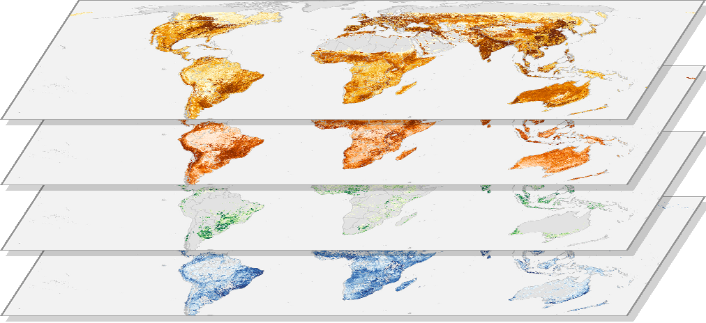{height="210px" fig-align="center"}
:::
::: {.column width="33%"}
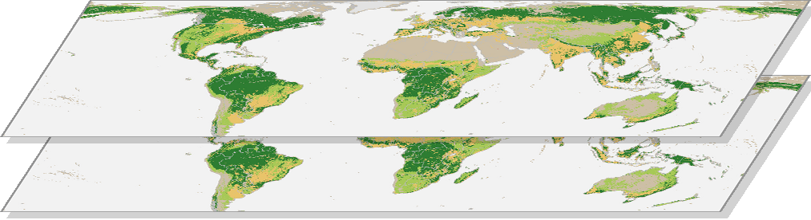{height="210px" fig-align="center"}
:::
::: {.column width="33%"}
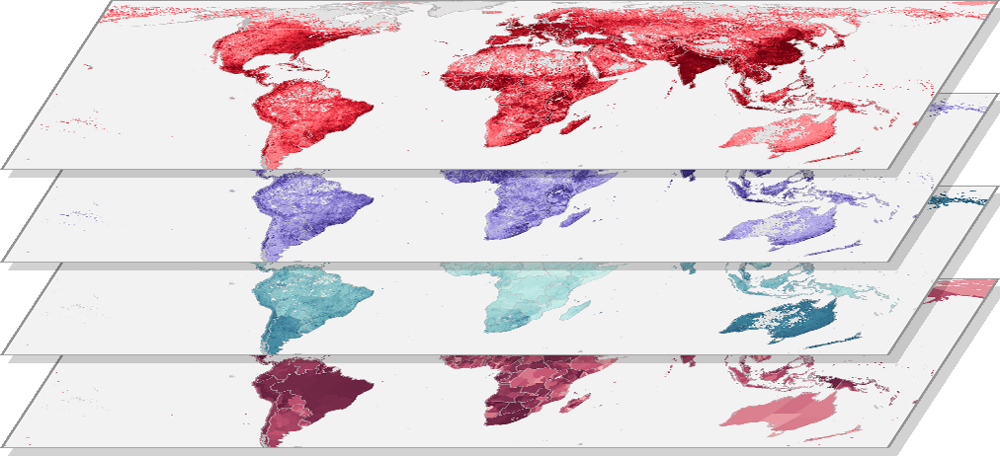{height="210px" fig-align="center"}
:::
:::

# Part 1: Motivation {background-color="#004D1E"}

## What We Know, and What Is Missing

::: {.columns style="font-size: 0.82em; align-items: flex-start;"}
::: {.column width="50%"}

### Context
- The provision of ecosystem services such as pollination, water quality regulation and coastal protection is declining globally [(Millennium Ecosystem Assessment, 2005; IPBES, 2019; Brauman et al., 2020)]{style="font-size: 0.8em;"}
- Billions of people depend on them for food, water, safety, health, and cultural and spiritual well-being [(Chaplin-Kramer et al., 2019, 2023)]{style="font-size: 0.8em;"}
- Losses are expected to be **geographically uneven**: where people's needs for nature are greatest, its ability to meet them is declining [(Chaplin-Kramer et al., 2019)]{style="font-size: 0.8em;"}

:::

::: {.column width="50%"}

### What global assessments still lack
- *What* changed, measured consistently over time and across services?
- *Where* does decline concentrate?
- *Who* is exposed to it?
- A way to ask these questions again, with other services, dates or groupings, and get comparable answers

::: {style="font-size: 0.62em; margin-top: 0.8em; color: #555;"}
Closest recent work: trends modelled from reconstructed land use and climate, 1900-2050 (Kim et al., 2024, *Science*); a composite supply-demand index by county, 2000-2020 (Peng et al., 2023). Neither combines observed land cover with per-service models at grid resolution, or links where change concentrates to the people exposed.
:::

:::
:::

::: {.notes}
- Left column: the established situation. Right column: the gap.
- If asked for numbers: the Millennium Ecosystem Assessment found about 60% of the 24 services it examined (15) degraded or used unsustainably; IPBES (2019) found 14 of the 18 categories of nature's contributions to people declined since 1970, mostly regulating and non-material ones.
- Dependence: at least 87% of the world's population lives in areas that benefit from critical natural assets for local contributions, while only 16% live on the lands holding them; those areas also contain 96% of the world's languages (Chaplin-Kramer et al., 2023, Nature Ecology & Evolution). Chaplin-Kramer et al. (2019, Science): up to 5 billion people face higher water pollution and insufficient pollination for nutrition under future land use and climate scenarios, especially in Africa and South Asia.
- Closest work, if asked: Kim et al. (2024, Science) is a multi-model ensemble driven by reconstructed land use and climate, so it gives modelled trends rather than change seen in satellite land cover; Peng et al. (2023, J. Cleaner Production) collapse services into one composite value index at county level. Our contribution is the combination: observed land cover, one process model per service, a 10 km grid, and the link to people.
- Unevenness is the weakest-established of the three bullets, and that is deliberate: earlier work shows it in snapshots and future scenarios, not as measured change over time. Measuring it is this paper's contribution (right column).
- Chaplin-Kramer et al. (2019, Science) mapped global NCP and who depends on it. This work extends it to change over time (1992 to 2020), hotspot detection and socioeconomic profiling.
- The last bullet is the thread for the whole talk: the contribution is as much the machinery as the specific numbers.
- ~2 min
:::

---

## Three Questions, One Pipeline {.questions}

::: {.columns}
::: {.column width="33%"}

### WHAT?
How did ecosystem service provision change between 1992 and 2020, in direction and magnitude?

:::

::: {.column width="33%"}

### WHERE?
Where is decline most intense, how often does it occur and how severe is it?

:::

::: {.column width="33%"}

### WHO?
Which populations live in or depend on the places where services declined most?

:::
:::

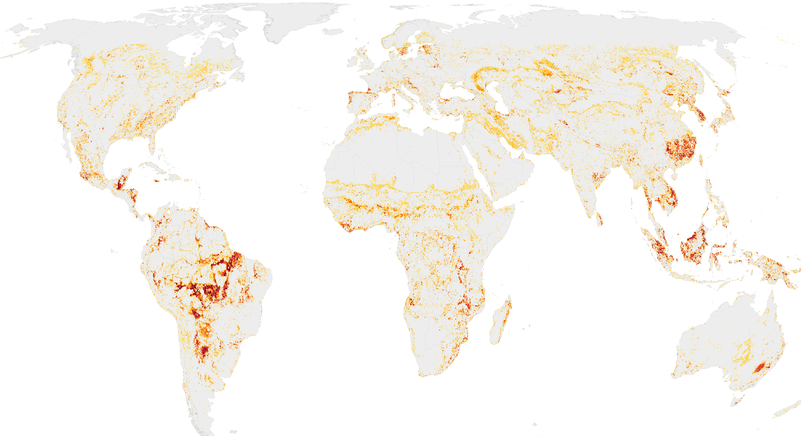{height="410px" fig-align="center"}

::: {.notes}
- Three questions, same structure as the paper: WHAT = Path A (native pixels summed to groups), WHERE = Path B hotspots on the 10 km grid, WHO = socioeconomic profiling and population exposure.
- The map: hotspots of decline, 1992-2020, darker where more services overlap (the paper's hotspot map, shown in full in the WHERE section).
- If someone asks about drivers (land cover, climate): not answered here; it comes back in the Discussion ("What the Analysis Cannot Say Yet").
- Earlier versions had a fourth pillar (WHY / land cover attribution). The paper now treats attribution as future work; the exploratory overlay is in the Supplement.
:::

---

## A Pipeline for Many Questions

::: {.columns style="font-size: 0.8em; align-items: flex-start;"}
::: {.column width="50%"}

### Every choice is an input
- **Services**: any modelled service layer (InVEST or another model), as rasters or points; five used here (coastal risk on shoreline points)
- **Dates**: any two snapshots; 1992 and 2020 here
- **Groupings**: any vector layer (regions, biomes, income groups, countries, basins, custom units, grids)
- **Metric**: relative (SPC) or absolute change
- **Hotspot rule**: threshold and direction per service
- **Scale**: native maps (300 m, 2 km, shoreline points), 10 km grid, or a finer regional grid

:::

::: {.column width="50%"}

### The same checks apply to every case
- Hotspot sensitivity to the change metric
- Do hotspots differ from typical places in population, GDP, HDI or inequality? A test for whether, and an effect size for how much
- Population exposure through downstream and travel links

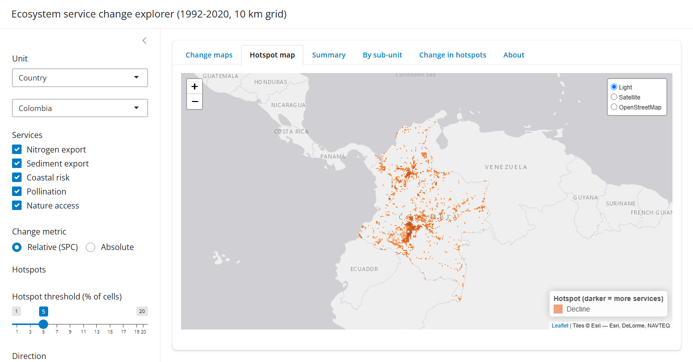{width="100%"}

:::
:::

::: {.notes}
- This is the message to carry through the talk: the findings that follow are one run of a general pipeline. Change the question and the answer changes, and the pipeline shows how much.
- Examples later in the talk: relative and absolute change pick different leading biomes (WHAT); SPC and absolute hotspots overlap 32-57% depending on the service (WHERE); prevalence and severity point to different places (WHERE).
- If asked about reuse: Colombia (2026), the same hotspot and prevalence machinery, run at country scale with biome groupings and a critical-asset overlay, for the WWF Colombia / ECLAC work.
- Global scope is an implementation choice, not an architectural constraint.
- Services: coastal risk comes as shoreline points, not a raster; its points are summarized onto the grid by a separate step (`summarize_cp_points_grid.py`) before joining the rest of the pipeline.
- Dates: ESA CCI land cover is yearly from 1992 to 2020, so a time series is possible; it needs a model run per year, which is the costly part.
- The "test + effect size" bullet is explained on the Statistical Analysis slide in Methods.
- Screenshot: the change explorer, where the same choices are controls; shown in Conclusions.
:::

# Part 2: Methods {background-color="#004D1E"}

## Analytical Pipeline {.pipeline}

```{mermaid}
%%{init: {'flowchart': {'rankSpacing': 38, 'nodeSpacing': 70, 'padding': 16}, 'themeVariables': {'fontSize': '18px'}}}%%
flowchart TB
    subgraph Inputs[" "]
        direction LR
        RawES["InVEST ES Models<br/>1992 & 2020<br/>300 m · 2 km · points"]
        RawGroups["Grouping Polygons<br/>countries · regions<br/>income · biomes"]
        RawGrid["10km Grid<br/>cells carry the<br/>group attributes"]
        RawSoc["Socioeconomic Data<br/>Pop · GDP · HDI · Gini"]
    end

    IntA["Path A<br/>Pixel-level"]
    MathA["Path A Metrics<br/>SPC & Abs. Δ"]
    P1(["WHAT<br/>Global Trajectories"])

    IntB["Path B<br/>10km Grid"]
    MathB["Path B Metrics<br/>SPC & Abs. Δ"]
    P2(["WHERE<br/>Hotspot Detection"])

    MathBenef["Serviceshed Routing<br/>population only<br/>50 km downstream<br/>1 h travel"]
    MathSoc["KS Tests &<br/>Socioec. Profile"]
    P4(["WHO<br/>Exposure & Profile"])

    RawES ==> IntA & IntB
    RawGroups ==> IntA
    RawGrid ==> IntB
    RawSoc ==> MathBenef & MathSoc

    IntA ==> MathA ==> P1
    IntB ==> MathB ==> P2

    P2 ==> MathBenef & MathSoc
    MathSoc ==> P4
    MathBenef ==> P4

    style Inputs fill:none,stroke:none

    classDef c_what fill:#007930,stroke:#004D1E,stroke-width:2px,color:#FFF;
    classDef c_where fill:#7B8327,stroke:#515619,stroke-width:2px,color:#FFF;
    classDef c_who fill:#F5D200,stroke:#B39900,stroke-width:2px,color:#333;

    class RawES,IntA,MathA,P1 c_what;
    class RawGroups c_what;
    class RawGrid,IntB,MathB,P2 c_where;
    class RawSoc,MathSoc,MathBenef,P4 c_who;
```

::: {.notes}
- Path A gives the group-level trajectories (WHAT); Path B identifies hotspots (WHERE), which feed the socioeconomic profiling and the exposure analysis (WHO).
- Inputs: Path A sums native-pixel change straight into the grouping polygons; Path B summarizes onto the 10 km grid, whose cells carry the same group attributes. The next slides follow the input boxes from left to right.
- Python (Docker) does the zonal extraction at 300 m; R/Quarto does change, hotspots and tests. Configs, not code edits, change the services, groupings and thresholds.
- Serviceshed routing (run by Rich): uses population only (LandScan 2023), with the DEM and sub-watersheds for downstream flow paths and a travel-friction surface for the 1 h reach. It produces service-area masks; any other raster (GDP, HDI, Gini) can be clipped with them by simple map algebra, with no rerun of the routing.
:::

---

## Data Inputs: 1992 & 2020 Global Layers

::: {.columns style="font-size: 0.66em;"}
::: {.column width="34%"}

{width="100%"}

### Ecosystem Services
**InVEST models, native resolution**

- Nitrogen export
- Sediment export
- Pollination
- Nature access
- Coastal risk (shoreline points, not shown)

300 m (2 km for nature access)

:::

::: {.column width="33%"}

{width="100%"}

### Land Cover
**ESA CCI + C3S, 300 m**

- 1992 & 2020 endpoints
- Main input to the InVEST runs
- Exploratory co-occurrence analysis (Supplement)

:::

::: {.column width="33%"}

{width="100%"}

### Socioeconomic
**Global gridded datasets, ~2020, summarised to the 10 km grid**

- Population: GHS-POP 2020 [(Schiavina et al., 2023)]{style="font-size: 0.8em;"}
- GDP [(Kummu et al., 2025)]{style="font-size: 0.8em;"}
- Human Development Index [(Sherman et al., 2026)]{style="font-size: 0.8em;"}
- Gini coefficient, subnational [(source to confirm)]{style="font-size: 0.8em;"}
- Agricultural field size [(Mehrabi et al., 2021)]{style="font-size: 0.8em;"}
- Exposure counts: LandScan 2023 [(ORNL)]{style="font-size: 0.8em;"}

:::
:::

::: {.notes}
- Time period: 1992 to 2020 (28 years). Land cover at the endpoints only, no annual transitions.
- The stacks are illustrations, listed top to bottom as in the text: services are 2020 InVEST outputs (colour by percentile); land cover is the dominant class per 10 km cell (forest, cropland, grassland, urban, other) rebuilt from the land cover change shares; socioeconomic layers are the 10 km grid values.
- Socioeconomic layers are snapshots around 2020, used to describe where hotspots are, not their change over time. Gini citation still to confirm: the layer is `rast_adm1_gini_disp_2020` (subnational Gini of disposable income), most likely from the Kummu group's dataset.
- GDP is total GDP per cell, not per capita, so it largely follows population.
- Two population sources: GHS-POP 2020 is the population variable in the socioeconomic tests; LandScan 2023 is used for all exposure counts (local residents and connected beneficiaries), because the beneficiary run was built on it. The explorer's "people in hotspots" uses GHS-POP, so its numbers differ slightly from the paper's.
- The same NDR, SDR and coastal vulnerability runs also give three ratios (nitrogen and sediment retention ratios, coastal risk reduction ratio). They are not used to define hotspots and are shown in the paper's Supplement only.
:::

---

## Five Ecosystem Services Define the Hotspots

::: {style="font-size: 0.78em;"}

| Theme | Service | What it measures | Adverse direction |
|:---|:---|:---|:---|
| **Habitat & Access** | Nature access | People's proximity to natural habitat | Decrease |
| | Pollination | Realized pollination on agriculture: pollinator-dependent crop production supported by nearby habitat (people fed / ha) | Decrease |
| **Coastal** | Coastal risk | Coastal vulnerability index at shoreline points, from habitats and exposure | Increase |
| **Water** | Nitrogen export | Nitrogen load delivered to streams | Increase |
| | Sediment export | Sediment load delivered to streams | Increase |

:::

::: {.callout-note style="font-size: 0.75em;"}
**Why export and risk, not retention?** They are what reaches people. A sediment retention *amount* can rise because land conversion generates more erosion to intercept, not because retention improved.
:::

::: {.notes}
- A cell is a hotspot for a service if it is in the most adverse 5% of that service's SPC.
- Nature access combines habitat with a population layer held fixed (2019) in both years, so its change reflects land cover, not population growth. It is the only hotspot service with population built in.
- Pollination is realized pollination on agriculture, not habitat suitability. It can rise when pollinator-dependent cropland expands next to remaining habitat (comes back on the WHAT slides).
- Ratios are not hotspot variables: export and retention of the same pollutant are not independent, and a retention ratio also depends on the load arriving from upstream.
:::

---

## Spatial Framework & Analytical Groupings

[*~1.37 M evaluated 100 km² cells; groupings are interchangeable*]{style="font-size: 0.7em;"}

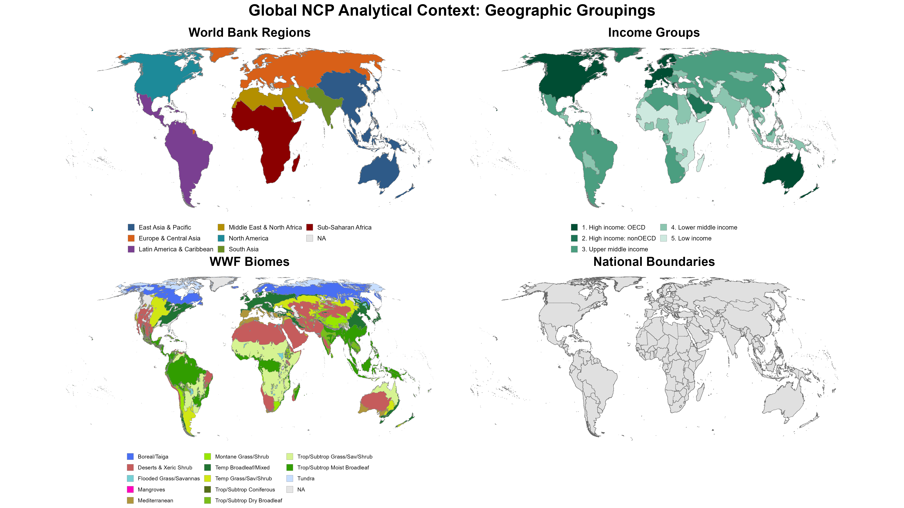{width="74%" fig-align="center"}

::: {.small-note}
Grid: IUCN Area of Occupancy 10 km equal-area grid (Murray, 2017). Countries, World Bank regions and income groups: NatCap TEEMs country correspondence table (ee_correspondence, J. Johnson). Biomes: WWF terrestrial ecoregions (Olson et al., 2001).
:::

::: {.notes}
- Evaluated cells: 1,522,073 grid cells minus Antarctica, open ocean, lakes and rock & ice = 1,372,621.
- Sources: Path A's zonal statistics use `cartographic_ee_r264_correspondence.gpkg` for countries, regions and income groups and a separate `Biome.gpkg` (WWF biomes, Olson codes) for biomes; the grid cells carry the same attributes. The paper's Methods still says biomes come from the correspondence table (to fix). Exact version and a citable reference for the correspondence table are still to confirm.
- The equal-area grid puts large and small ecosystems on equal footing.
- World Bank regions: policy framing. Income groups: equity lens. Biomes: ecological framing. Countries: operational scale.
- These four are the ones used in the paper; any other vector layer (a basin, a protected-area network, a jurisdiction) plugs in the same way.
:::

---

## Socioeconomic Context: The WHO Input Layers

{height="540px" fig-align="center"}

::: {.small-note}
Gridded layers joined to each 10 km cell. Population: GHS-POP 2020 (Schiavina et al., 2023). GDP: Kummu et al. (2025). HDI: Sherman et al. (2026). Gini: subnational Gini of disposable income, 2020 (source to confirm).
:::

::: {.notes}
- Population and GDP turn out to be high in hotspots of every service, so they do not distinguish services. Gini separates the land services from coastal risk, and HDI marks coastal risk (WHO section).
- GDP is total GDP per cell, not per capita.
- All layers are 2020 values, a temporal mismatch with the 1992-2020 change window. Acknowledged limitation.
- If asked about the legends: log scales without units (population, GDP); a fix to the figure is pending.
:::

---

## Why Two Pathways?

::: {.columns style="font-size: 0.84em; align-items: flex-start;"}
::: {.column width="50%"}

### Path A: native pixels
*Compare first, then aggregate*

- Each pixel compared 1992 → 2020 at native resolution
- Zonal statistics straight to the grouping polygons (countries, regions, income groups, biomes)
- **Used for:** WHAT

:::
::: {.column width="50%"}

### Path B: 10 km equal-area grid
*Aggregate first, then compare*

- Native rasters summarised into ~1.37 M evaluated cells before computing change
- Every cell = 100 km², so cells can be ranked globally
- Each cell carries its country, region, income group and biome, so grid results can be regrouped the same way (e.g. hotspot prevalence by region)
- **Used for:** WHERE and WHO

:::
:::

::: {.callout-note style="font-size: 0.75em; margin-top: 0.5em;"}
**Why not one path?** The order of aggregation and differencing matters: averaging grid values up to broad regions can flip the sign between absolute and relative change (a MAUP effect). Path A avoids the intermediate grid.
:::

::: {.notes}
- Path A: diff then aggregate. Path B: aggregate then diff. Different questions, different orders.
- Found empirically: a mean of per-cell percentage changes can have the opposite sign to the change in totals for the same region. Both are correct at their scale; group results therefore use the SPC of group totals.
:::

---

## Measuring Change, Defining Hotspots

::: {.columns style="font-size: 0.85em;"}
::: {.column width="50%"}

### Symmetric Percentage Change (SPC)

<div style="font-size:0.75em">
$$\text{SPC} = \frac{T_{2020} - T_{1992}}{(|T_{2020}| + |T_{1992}|) / 2} \times 100$$
</div>

Change relative to the local baseline (the cell's mean of 1992 and 2020); symmetric around zero; comparable across services. Bounded −200% (service fell to zero) to +200% (emergence).

### Absolute change

<div style="font-size:0.75em">
$$\Delta = T_{2020} - T_{1992}$$
</div>

In each service's units: Not comparable across services, and it highlights places with a high baseline.

:::

::: {.column width="50%"}

### Hotspot definition
- **Metric**: SPC; absolute change as a sensitivity check
- **Ranked within each service** by SPC
- **Most adverse 5%** per service 
- **Multi-service hotspot**: a cell that is a hotspot for 2+ services
- **Relative prevalence**: a group's share of hotspots ÷ its share of the area where the service is modelled

:::
:::

::: {.notes}
- SPC divides by the mean of the two years, not by 1992 alone. It stays defined when one year is near zero, treats gains and losses symmetrically, and is unitless, so services can be ranked the same way.
- Same formula written another way: SPC = 200 × (2020 − 1992) ÷ (2020 + 1992).
- Worked example: 10 t in 1992, 43 t in 2020. SPC = 200 × 33 ÷ 53 = +124%. The 2020 value is 4.3 times the 1992 value (ordinary change +330%).
- Back to a ratio: 2020 ÷ 1992 = (200 + SPC) ÷ (200 − SPC). Quick values: +67% = doubled, +100% = tripled, +124% = about four times, −67% = halved, −102% = lost two thirds, −169% = lost over 90%, −200% = fell to zero. Full table in the appendix ("Reading SPC Values").
- SPC is not an ordinary percentage: close to it up to about ±40, compressed beyond.
- Example of the difference: a cell exporting 1,000 t that rises 10% (+100 t) vs a cell exporting 10 t that rises to 30 t (+20 t). Absolute change ranks the first higher; SPC ranks the second higher (+100%). SPC highlights the opposite of absolute change: places with a low baseline.
- Ranking is among the cells where the service is modelled: coastal risk only on 79,473 coastal cells, nature access on 1,354,611; the other three on all 1,372,621.
- Relative prevalence example: a group with 10% of the area and 20% of the hotspots has 2.0: its share of hotspots is twice its share of the area; 1 = the two shares are equal.
- 189,932 cells are a hotspot for at least one service (13.8% of evaluated cells).
:::

---

## Statistical Analysis: KS Tests + Cliff's Delta

::: {.columns style="font-size: 0.8em;"}
::: {.column width="50%"}

**Hotspot cells** vs. **background cells**
(47.5th-52.5th percentile of each service's change: typical, stable conditions), compared on each socioeconomic layer (+ agricultural field size)

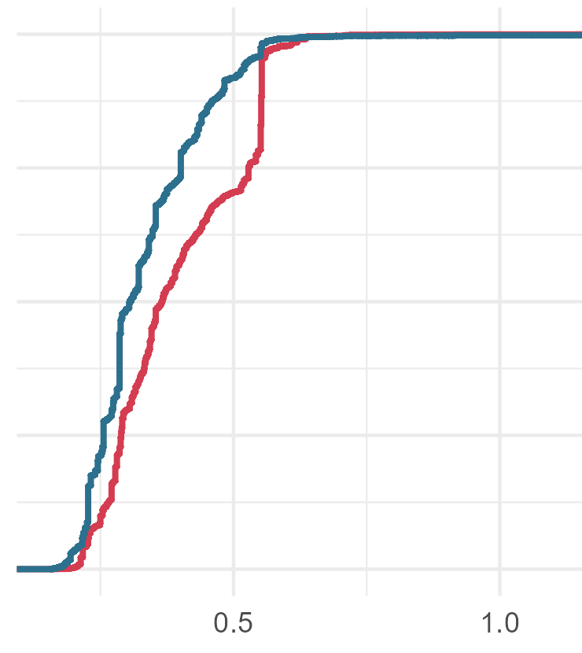{height="300px"}

:::

::: {.column width="50%"}

**Two-step interpretation:**

1. *Kolmogorov-Smirnov test* (FDR-corrected): are the values in hotspot cells and in background cells two different distributions?
2. *Cliff's Delta (δ)*: take one hotspot cell and one background cell at random; δ = P(hotspot higher) − P(background higher), from −1 to +1, 0 = no difference

With up to ~68,000 cells per group almost any difference is significant, so δ carries the interpretation.

**Used in WHO:** what kind of places hotspots are (more populated, more economic activity, more unequal?).

:::
:::

::: {.notes}
- Background = the middle 5% of the change distribution, which keeps cells with large gains out of the comparison.
- 25 tests (5 services × 5 variables), Benjamini-Hochberg corrected. 24 of 25 differ; the exception is coastal risk × field size.
- In plain words: KS compares the whole shape of the two sets of values (e.g. Gini in hotspot cells vs Gini in stable cells), not only their means. With this many cells it says "different" almost always, so it is only the first filter.
- Cliff's δ reads as a comparison of random pairs: δ = 0 means a random hotspot cell is as likely to be higher as lower than a random background cell; δ = +0.25 means it is the higher one 25 percentage points more often than the lower one. (Converting to "x in 10 pairs" assumes few ties; Gini is subnational, so many cells share a value and that conversion would overstate it.)
- It works on ranks, so it is not distorted by skewed variables such as population and GDP, and it puts all five variables on the same −1 to +1 scale.
- How δ is computed: every hotspot cell is paired with every background cell; +1 if the hotspot cell is higher, −1 if lower, 0 if tied; δ is the average. Rank-based relative of the Mann-Whitney test (δ = 2·AUC − 1).
- Thresholds (Romano et al., 2006): < 0.15 negligible, 0.15-0.33 small, 0.33-0.47 medium, > 0.47 large. Ties score 0, so for Gini (many cells share one sub-national value) δ is if anything conservative.
- The chart: KS D is the largest vertical gap between the two lines (about 0.3 here). The big vertical steps in the red line are many hotspot cells sharing one sub-national Gini value.
- FDR (Benjamini-Hochberg): 25 tests at 5% would give about one false positive by chance; BH keeps the expected share of false positives among significant results at 5%. Here it changes almost nothing: the p-values are tiny, which is why δ carries the interpretation.
:::

# Part 3: Results {background-color="#004D1E"}

# WHAT: Change Depends on How You Measure It {background-color="#007930"}

## WHAT: Absolute vs. Relative Change Map Different Places

::: {.panel-tabset style="font-size: 0.55em;"}

### Relative change (SPC)

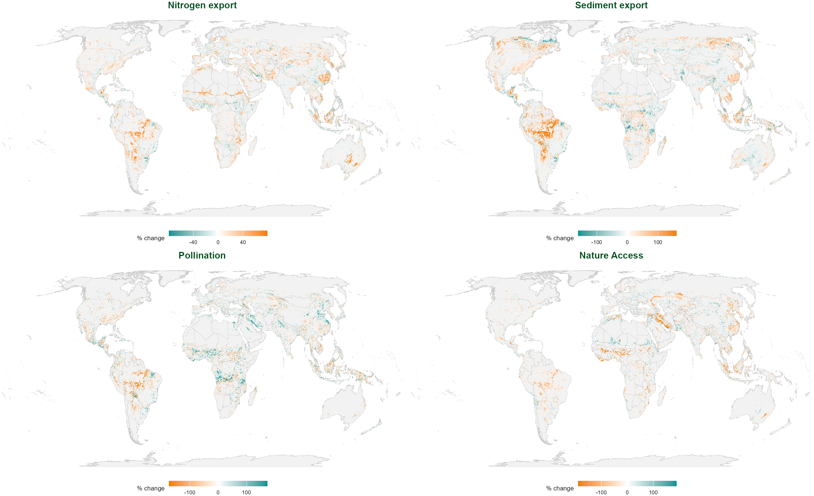{height="500px" fig-align="center"}

### Absolute change

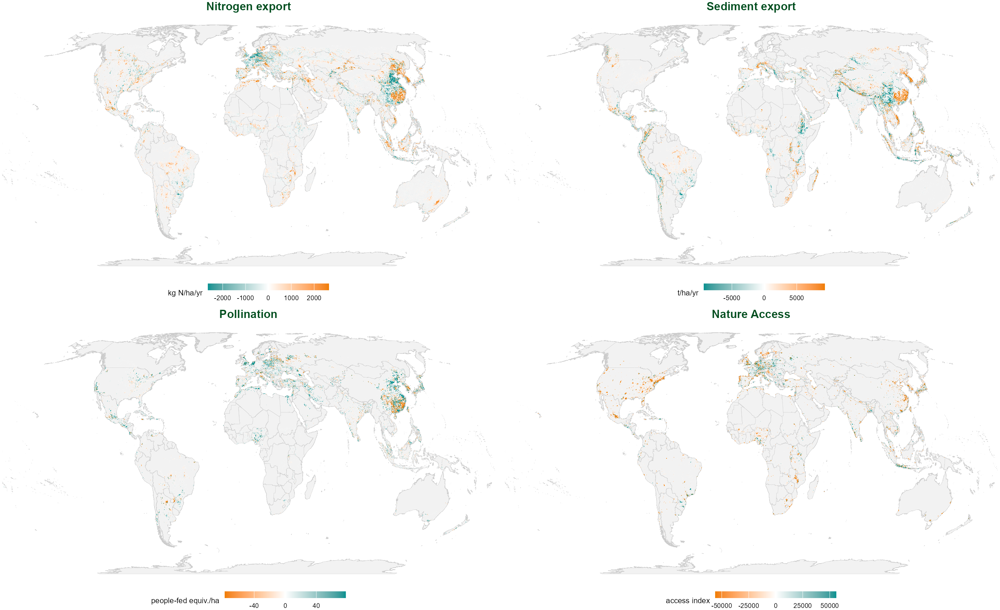{height="500px" fig-align="center"}

### Side by side

::: {.columns .tight-maps}
::: {.column width="50%"}
{width="100%"}
:::
::: {.column width="50%"}
{width="100%"}
:::
:::

:::

::: {.small-note}
Change per 10 km cell.
:::

::: {.notes}
- Path B, native 10 km grid, before any hotspot threshold. Deck copies of the paper's two figures with the white space between panels removed (images/*_tight.png). Coastal risk is too thin to see at this scale; it gets its own slide.
- SPC flags fast, disproportionate change against each place's own baseline; absolute change flags where the most material moved. The paper uses SPC as the main measure (Methods) and absolute change as a check.
:::

---

## WHAT: Global Change, Different Groupings

[*Global, 1992-2020: N export +1.6% · sediment export +1.4% · nature access −8.7% · pollination +6.9% · coastal risk <0.1%. Left: absolute change; right: relative change (SPC).*]{style="font-size: 0.55em;"}

::: {.panel-tabset style="font-size: 0.6em;"}

### Biome

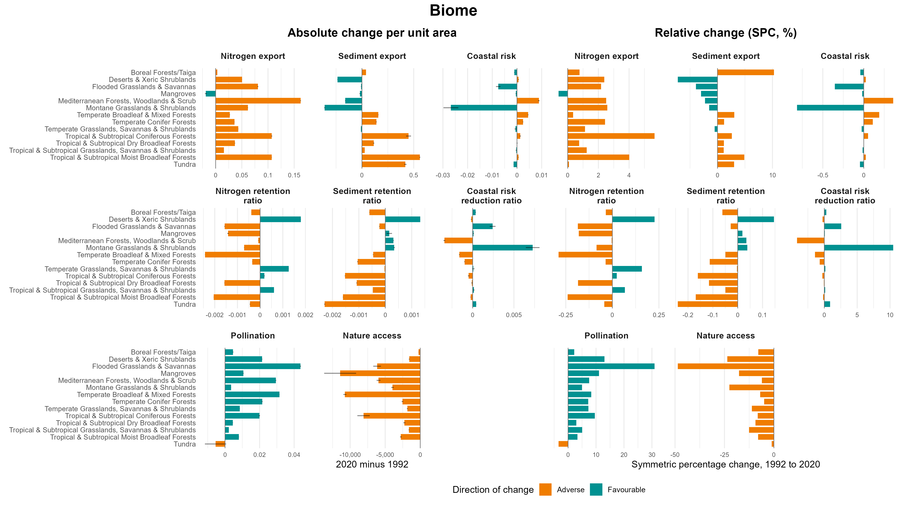{height="470px" fig-align="center"}

### World Bank region

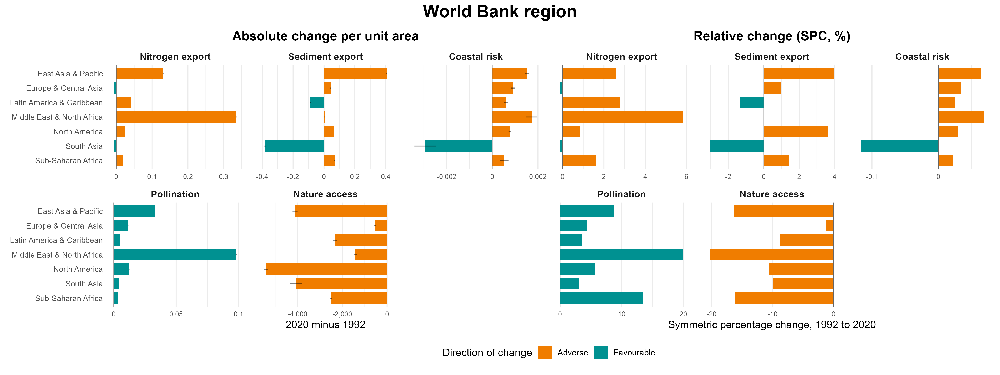{height="470px" fig-align="center"}

### Income group

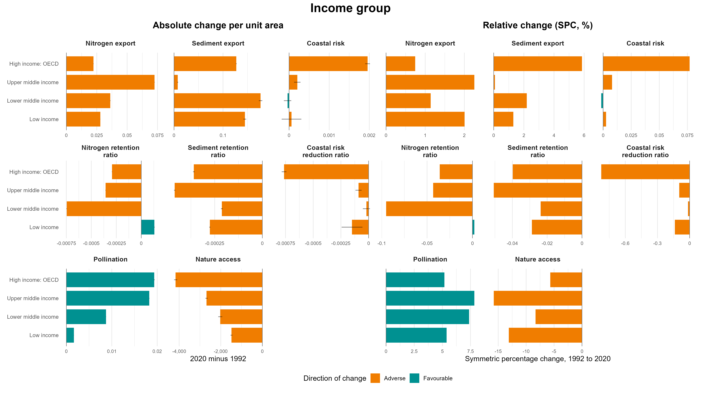{height="470px" fig-align="center"}

### Countries (largest changes)

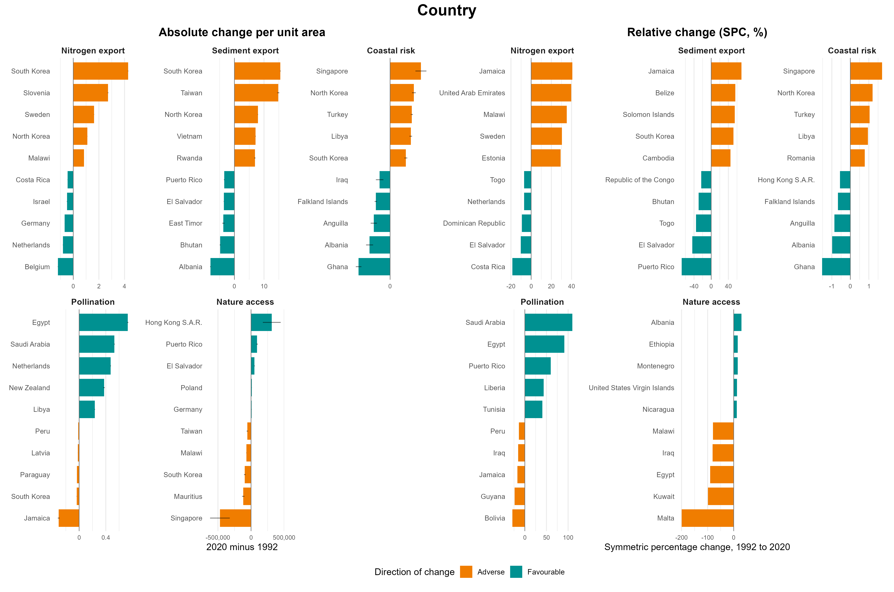{height="470px" fig-align="center"}

:::

::: {.notes}
- Nature access fell in every biome and every region.
- The leading biome depends on the measure. Sediment export rose most in relative terms in Boreal Forests/Taiga (+10.3%, low baseline) but most in absolute terms per unit area in Tropical & Subtropical Moist Broadleaf Forests (+4.9% relative). Nature access fell most steeply in relative terms in Flooded Grasslands & Savannas (−48.6%) but lost the most per unit area in Mangroves and Temperate Broadleaf forests.
- Explore: neither ranking is "the" answer; they answer different questions (share of a place's own capacity vs largest quantities).
- Tabs: the same native-pixel change, summed by biome, World Bank region, income group, and the countries with the five largest increases and decreases per service (smallest 10% of countries by evaluated area excluded). Same pipeline, only the grouping layer changes. Region, income and country versions are in the paper's Supplement.
:::

---

## WHAT: The case of Polliation

::: {.columns style="font-size: 0.74em; align-items: center;"}
::: {.column width="44%"}

- Realized pollination: crop production supported by wild pollinators. It only exists on farmland
- Rose in every region (+6.9% globally)
- More new cropland: larger average gain, deeper nature access loss
- The gain comes from a few cells; many others lose a little
- Flooded Grasslands & Savannas: largest pollination gain (+31%), steepest nature access loss (−49%)

::: {.callout-important}
A change in the *favourable* direction is not always good news. Each variable needs its own reading before it is aggregated.
:::

:::
::: {.column width="56%"}

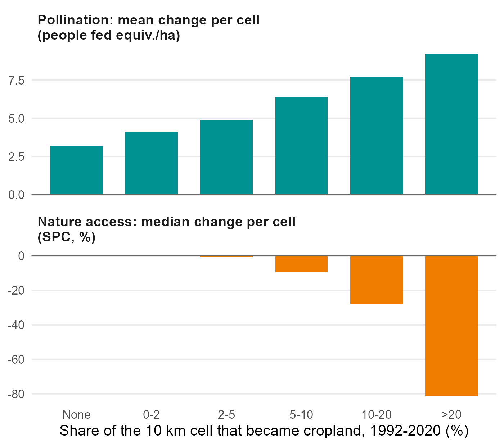{height="520px" fig-align="center"}

:::
:::

::: {.notes}
- This is the global-average trap: pollination going up looks like an improvement, but here it is the footprint of agricultural expansion into still-habitat-rich landscapes. If conversion continues until the habitat is gone, pollination would eventually fall too.
- Slicing (Path A, SPC): all 7 World Bank regions rose (South Asia +3.1% to MENA +20.0%); all income groups rose (+5.2% to +7.8%); 13 of 14 biomes rose, Tundra fell (−3.4%); 133 of 165 countries rose.
- Same logic for the sediment retention amount (rises with land-conversion erosion), which is why the paper uses export.
- Chart: 796,003 cells with both land cover change and pollination data (cells are grouped by the share that became cropland; script scripts/mapping/make_deck_pollination_cropland.R). Mean pollination change rises from +3.2 (no new cropland) to +9.2 people fed equiv./ha (>20% new cropland); median nature access change falls from 0 to −81.5%. Cells with no new cropland still gain a little, so cropland expansion is not the only reason pollination rose. Co-occurrence, not attribution.
- Concentration (10 km grid, all 1.37 M cells): 65% of cells have no pollination change (no farmland), 19% gain, 16% lose. The top 1% of cells hold 75% of all gains; the top 5% hold 98%.
- Only the mean absolute change rises with cropland gain. The median pollination change is about zero in every group, and in SPC it turns slightly negative with more cropland (median −2.2%, mean −16% in the >20% group). Reading: a few cells with new cropland next to remaining habitat gain a lot; most converting cells lose a little as habitat is cleared. Nature access falls in every unit and summary.
- Why the units differ: pollination is mostly zero, so a median or SPC hides the gains that make up the global total; the mean absolute change is what adds up to the +6.9%. Nature access is shown as median SPC because its absolute values vary by orders of magnitude.
- Within each cropland group about a third of cells gain; what grows with cropland expansion is the size of the gain, not how many cells gain.
:::

---

## WHAT: Coastal Risk

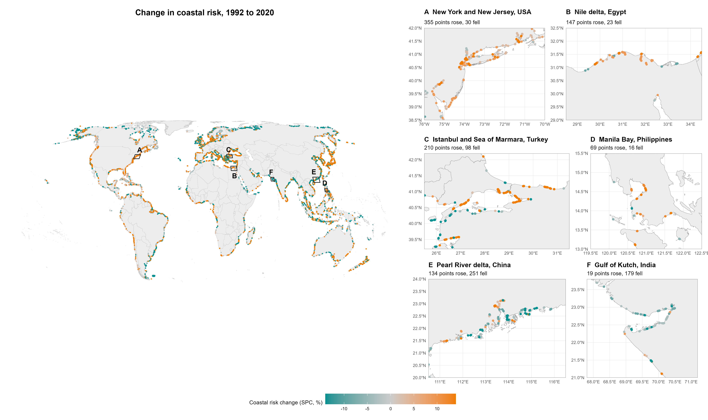{height="530px" fig-align="center"}

::: {.small-note}
Windows chosen by **population**, not by change intensity: A-D are densely populated coasts where risk rose, E-F where it fell.
:::

::: {.notes}
- Coastal risk changed at 4.6% of 1.37 M shoreline points, and changes are small (within about ±18% SPC).
- Increases and decreases are spread along most coastlines in similar numbers (23,591 rose and 21,111 fell by at least 1%).
- Panels: New York/New Jersey, Nile delta, Istanbul/Sea of Marmara, Manila Bay (rose); Pearl River delta, Gulf of Kutch (fell).
- How the windows were chosen (rule in scripts/mapping/make_coastal_risk_zooms.R, 10-05): coastal 5-degree boxes ranked by the people (GHS-POP 2020) living in cells where coastal risk changed by 1% or more. A-D: the most populated boxes where it rose, one per continent; E-F: the two most populated where it fell. Ranking by size of change would have picked empty coasts, since changes are small and rises and falls are spread along most coastlines; ranking by people ties the figure to exposure. E-F show that risk did not only go up.
- If asked whether these are exactly the top boxes: approximately. A quick recompute on the 10 km grid puts Manila, New York/New Jersey, Istanbul and the Nile delta near the top, but Mumbai (6.5 M people) edges Manila (6.4 M), Lagos (3.5 M) edges the Nile delta (3.2 M), and Bangladesh (2.2 M) ranks above the Gulf of Kutch (about 1.9 M) for decreases. The differences are small and may come from box alignment or shoreline points vs grid cells; the original ranking was not saved. Safe wording: "densely populated coasts where risk rose or fell".
:::

# WHERE: How Often and How Severe {background-color="#004D1E"}

## WHERE: Hotspots Cluster in Latin America and East Asia {.tight-figs}

::: {.small-note}
*189,932 hotspot cells (13.8% of 1.37 M evaluated cells)*
:::

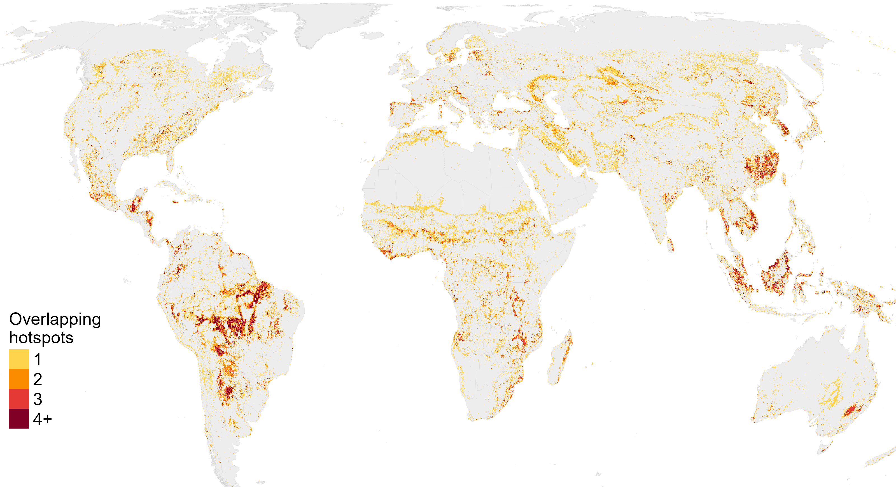{height="385px" fig-align="center" fig-alt="Number of overlapping hotspots per 10 km cell"}

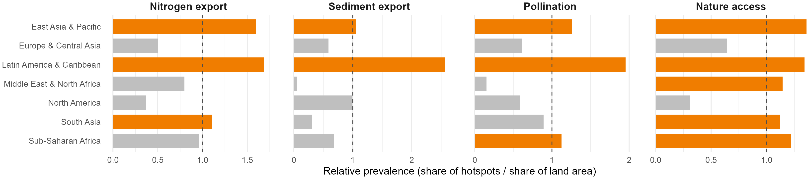{height="165px" fig-align="center"}

::: {.notes}
- Hotspots cluster in space; they are not random scatter.
- Averaged over the four land-based services, relative prevalence is highest in Latin America & Caribbean (1.9) and East Asia & Pacific (1.3); Sub-Saharan Africa is at 1.0; Europe & Central Asia, North America and MENA around 0.6.
- Multi-service cells (darkest) are where a single intervention could address several declines.
- Map: deck version of the paper's hotspot map, cropped to the land (no Antarctica), legend inside the frame; the paper's PNG has a stray line across the Arctic (to fix in the paper figure). Redrawn from the explorer data: 189,927 cells in at least one hotspot vs the paper's 189,932 (ties at the 5% cutoff; numbers-audit item).
- ~90 seconds
:::

---

## WHERE: Frequency and Severity Are Different Questions

::: {.columns style="align-items: flex-start;"}
::: {.column width="62%"}

```{=html}
<div class="hl-wrap">
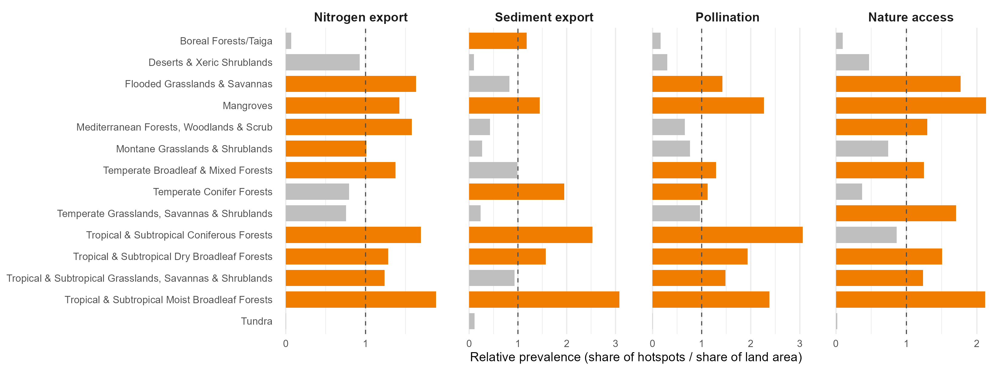
<div class="hl fragment fade-in-then-out" data-fragment-index="1" style="left:46.0%;top:77.6%;width:16.6%;height:6.4%;"></div>
<div class="hl fragment fade-in-then-out" data-fragment-index="2" style="left:64.5%;top:60.2%;width:16.4%;height:6.4%;"></div>
<div class="hl fragment fade-in-then-out" data-fragment-index="3" style="left:82.9%;top:13.6%;width:16.6%;height:6.4%;"></div>
<div class="hl fragment fade-in-then-out" data-fragment-index="4" style="left:27.8%;top:7.4%;width:17.8%;height:83.0%;"></div>
</div>
<p class="hl-cap">(a) How often: relative prevalence by biome.</p>
<div class="hl-wrap">
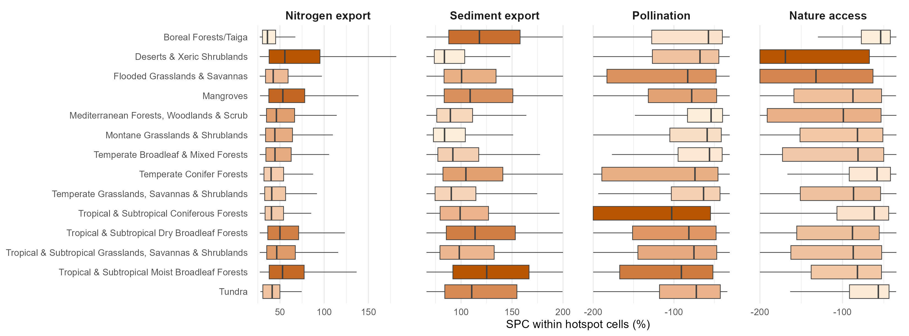
<div class="hl fragment fade-in-then-out" data-fragment-index="1" style="left:46.0%;top:77.6%;width:16.6%;height:6.4%;"></div>
<div class="hl fragment fade-in-then-out" data-fragment-index="2" style="left:64.5%;top:60.2%;width:16.4%;height:6.4%;"></div>
<div class="hl fragment fade-in-then-out" data-fragment-index="3" style="left:82.9%;top:13.6%;width:16.6%;height:6.4%;"></div>
<div class="hl fragment fade-in-then-out" data-fragment-index="4" style="left:27.8%;top:7.4%;width:17.8%;height:83.0%;"></div>
</div>
<p class="hl-cap">(b) How much: SPC within hotspot cells by biome. −200% = the service fell to zero.</p>
```

:::
::: {.column width="38%" .fs56}

**Frequent and severe**

- Tropical moist forests: 3x area share of sediment export hotspots. In 2020, export in a typical hotspot was 4.3 times its 1992 level.
- Tropical coniferous forests: 3x their share of pollination hotspots. Pollination fell by 2/3 in the typical hotspot

**Rare but severe**

- Deserts: 0.5x the share of nature access hotspots. A typical hotspot lost over 90% of its provision. 42% of the hotspots lost access entirely

**Same severity everywhere**

- Nitrogen export: a typical hotspot rose 40-75% in every biome. Biomes differ in how many hotspots they have, not in how much export rose

:::
:::

::: {.notes}
- New in the 10-06 revision of the paper. Prevalence says where hotspots cluster; within-hotspot SPC says how bad they are.
- Converting SPC to a plain ratio: 2020/1992 = (200 + SPC) / (200 − SPC). +124% -> 4.3× (roughly quadrupled); −102% -> 0.32 (lost about two thirds); −169% -> 0.08 (lost over 90%); +35% -> 1.42 and +55% -> 1.76. SPC runs from −200% (service fell to zero) to +200% (appeared from zero). The conversion is monotonic, so it holds for medians.
- Source: outputs/tables/hotspot_spc_within_hotspots.csv (e.g. sediment export, tropical moist broadleaf: 30,621 hotspot cells, median +123.8%, IQR +90% to +166%).
- Two prioritization logics: go where hotspots are frequent (most cells, most co-benefit), or where they are rare but the service is lost outright.
- Flooded Grasslands & Savannas combine both for nature access (prevalence 1.8, median −132%, 34% total loss).
- Every hotspot is already past one global cutoff (nature access SPC ≤ −34.5%, pollination ≤ −29.7%), so panel (b) shows how far past it the typical hotspot goes. Compare boxes within a service, not across services.
- Values: sediment export, tropical moist forests prevalence 3.0 (45% of hotspots on 15% of the area), median +124%; pollination, tropical coniferous 3.0, median −102%; nature access, deserts 0.47, median −169%, 42% total loss (2,737 cells, 85 M people, two thirds in MENA); nitrogen export medians +35% to +55%.
- If asked about pollination total losses (30% of tropical coniferous hotspots): those cells had almost no pollination in 1992 (median 0.005 vs 3.98 people fed/ha for the biome; 0.24 M people), so "lost it all" means little in absolute terms. Left off the slide for that reason.
- If asked about deserts: ESA CCI switching between sparse vegetation and bare ground may play a role; not tested.
- Sediment caveat: SPC sediment hotspots sit mostly where export was low (hidden backup slide "The Hotspot Set Depends on the Metric"), so "quadrupled" is often a fourfold rise of a small amount.
:::

---

## WHERE: Coastal Risk Hotspots

::: {.columns style="align-items: flex-start;"}
::: {.column width="62%"}

```{=html}
<div class="hl-wrap">
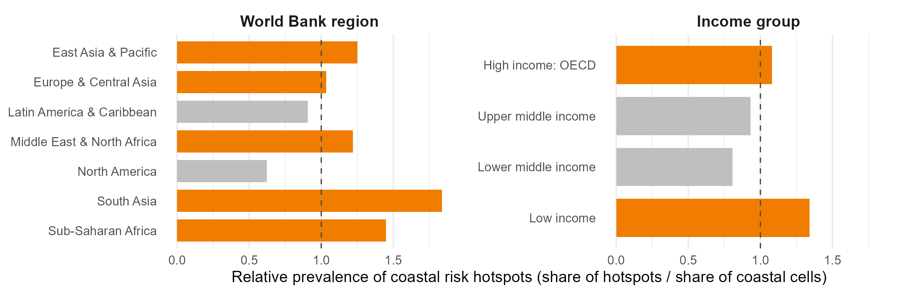
<div class="hl fragment fade-in-then-out" data-fragment-index="1" style="left:19.0%;top:64.3%;width:31.0%;height:8.6%;"></div>
<div class="hl fragment fade-in-then-out" data-fragment-index="1" style="left:19.0%;top:74.5%;width:31.0%;height:8.6%;"></div>
<div class="hl fragment fade-in-then-out" data-fragment-index="1" style="left:19.0%;top:54.2%;width:31.0%;height:8.6%;"></div>
<div class="hl fragment fade-in-then-out" data-fragment-index="1" style="left:67.6%;top:67.2%;width:29.6%;height:14.5%;"></div>
<div class="hl fragment fade-in-then-out" data-fragment-index="2" style="left:67.6%;top:14.9%;width:29.6%;height:14.5%;"></div>
<div class="hl fragment fade-in-then-out" data-fragment-index="4" style="left:19.0%;top:74.5%;width:31.0%;height:8.6%;"></div>
</div>
<p class="hl-cap">(a) Relative prevalence against coastal cells.</p>
<div class="hl-wrap">
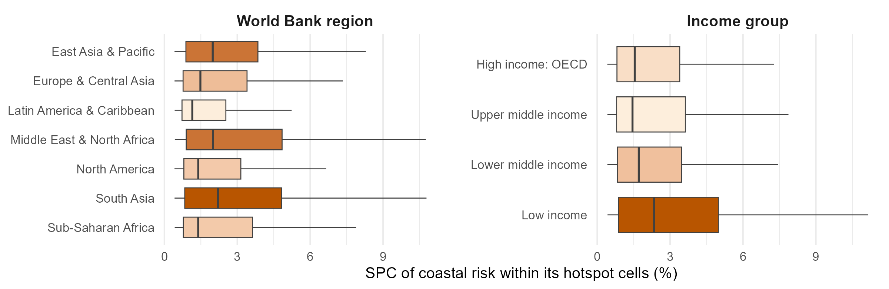
<div class="hl fragment fade-in-then-out" data-fragment-index="3" style="left:66.5%;top:67.2%;width:31.5%;height:14.5%;"></div>
<div class="hl fragment fade-in-then-out" data-fragment-index="3" style="left:18.3%;top:64.3%;width:31.5%;height:8.6%;"></div>
<div class="hl fragment fade-in-then-out" data-fragment-index="4" style="left:18.3%;top:74.5%;width:31.5%;height:8.6%;"></div>
</div>
<p class="hl-cap">(b) SPC of coastal risk within its hotspot cells.</p>
```

:::
::: {.column width="38%" .fs68}

- Measured against coastal cells only 
- Above global average in South Asia (1.8), Sub-Saharan Africa (1.4) and on low-income coasts (1.3); below in North America (0.6)
- Slightly over-represented on high-income OECD coasts (1.1)
- Low-income coastal regions and South Asia have the largest increases (median +2.3% and +2.2%)
- Sub-Saharan Africa: more hotspots, but not more severe (+1.4%)

:::
:::

::: {.notes}
- Changes are small everywhere (medians 1-2.5%).
- About 40% of coastal risk hotspots fall in coastal cells outside the grouping layers, so these group results rest on ~60% of the hotspots.
- The earlier deck/paper figure (Mangroves 15×) used all land cells as the denominator; against coastal cells Mangroves are ~1.0.
:::

---

## WHERE: The Hotspot Set Depends on the Metric {visibility="hidden"}

::: {.columns style="align-items: flex-start;"}
::: {.column width="44%" .fs56}

Hotspots ranked by relative change (SPC) vs absolute change, each the 5% most adverse cells:

| Service | Overlap | 1992 level, SPC-only vs absolute-only | People, SPC-only / absolute-only |
|:---|---:|---:|---:|
| Nitrogen export | 57% | 25× lower | 191 M / 442 M |
| Nature access | 43% | 870× lower | 100 M / 975 M |
| Pollination | 35% | 1,000× lower | 108 M / 546 M |
| Sediment export | 32% | 1,300× lower | 66 M / 418 M |

- The overlap reads the same either way round: both sets are the same size
- SPC only: a large share of a small baseline, in low-provision landscapes (Amazon, boreal, drylands), mostly Latin America and Sub-Saharan Africa
- Absolute only: large amounts in high-provision, densely used landscapes (mountain ranges, East Asia, Europe), with 2-10× more people
- The metric changes who counts as exposed, not only where; the paper's WHO results use SPC

:::
::: {.column width="56%"}

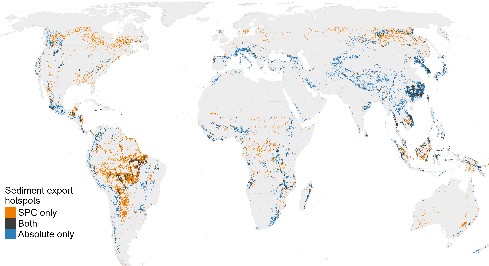{width="100%"}

:::
:::

::: {.notes}
- Overlap = share of SPC hotspot cells that are also hotspots by absolute change. Both rankings take the 5% most adverse of the same cells, so the two sets are the same size and the share is identical read the other way round (checked: 57/43/35/32% both ways).
- 1992 level: median baseline of the cells that are hotspots under only one metric, recovered from the two change columns (SPC = 200(b−a)/(a+b), abs = b−a). For sediment export, SPC-only hotspots started about 1,300 times lower than absolute-only ones.
- Typical change also differs: sediment export SPC-only hotspots rose by a median +111% SPC vs +22% for absolute-only; pollination −82% vs −9%.
- People: GHS-POP 2020 living in the cells (local residents), not the LandScan exposure counts.
- So SPC flags places losing a large share of what little they had (frontier landscapes); absolute change flags where the most material moved (productive, populated landscapes). Both are legitimate questions; the paper chose SPC and says so. A WHO analysis on absolute hotspots would shift toward East Asia, Europe and North America.
- Coastal risk is left out: it is a unitless exposure index between about 1 and 5 (shoreline points: median 2.4, 1st-99th percentile 1.4-4.4), so the two rankings coincide (97% overlap, Spearman 0.9999) and the row says nothing about the choice of metric.
- Source: scripts/mapping/make_deck_metric_overlap.R -> outputs/tables/hotspot_metric_overlap_profile.csv.
:::

# WHO: Inequality, Not Just Poverty {background-color="#007930"}

## WHO: The Same Hotspots, Grouped by Income {.tight-figs}

[*Same two measures as for biomes (how often, how severe), now grouped by each country's income group*]{style="font-size: 0.6em;"}

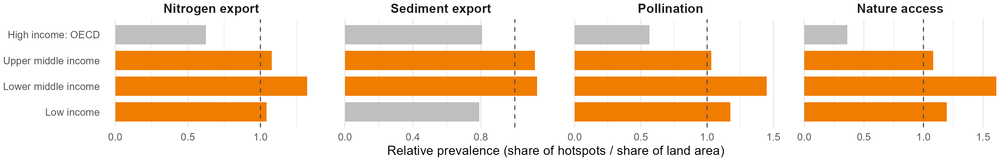{width="100%"}

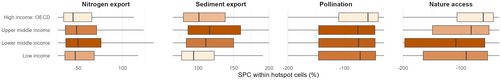{width="100%"}

::: {.columns style="font-size: 0.6em;"}
::: {.column width="50%"}
- Lower-middle-income countries: above 1 for all four services (1.1-1.6), highest for nature access
- High-income OECD: below 1 for all four (0.4-0.8)
:::
::: {.column width="50%"}
- Largest gap for nature access: 1.6 in lower-middle-income vs 0.4 in high-income OECD
- Nature access losses are also deepest there: median −109% vs −62% in high-income OECD; 22% vs 8% of hotspots lost access entirely
:::
:::

::: {.notes}
- Transition: WHO starts with the same hotspots and the same two charts, only the grouping changes, from biomes to income groups (the pipeline point: grouping is an input). Then it gets finer: income group is a country-level label; the next slide asks what the hotspot cells themselves are like (population, GDP, HDI, sub-national Gini); the one after counts the people connected to them.
- More frequent and more severe in the same income group: the two dimensions reinforce each other here, unlike some biomes.
- If asked for one number (the paper's 2.3×, not on the chart, pooled over services): summed over the four land services, lower-middle-income countries hold 21.4% of service hotspots on 15.6% of the land (ratio 1.38); high-income OECD 14.6% on 24.7% (0.59); 1.38 / 0.59 = 2.3. A cell that is a hotspot for two services counts twice. Per service (chart): lower-middle 1.13 sediment, 1.32 nitrogen, 1.45 pollination, 1.61 nature access; OECD 0.81, 0.62, 0.57, 0.36.
- The 2.3× replaces the older 1.8× (which compared people, not land, and came from an earlier hotspot table).
:::

---

## WHO: Inequality Separates the Services

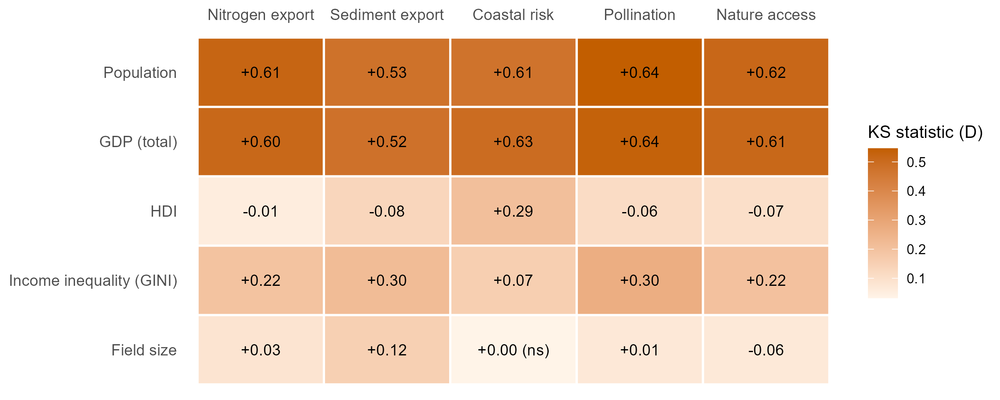{height="320px" fig-align="center"}

::: {.columns style="font-size: 0.7em;"}
::: {.column width="50%"}

### Shared by all five services
Hotspots are more populated and higher-GDP than typical cells (δ +0.52 to +0.64, a large difference). Because this holds everywhere, it does not tell services apart.

### Land-based services
Hotspots sit in more unequal places (Gini δ +0.22 to +0.30, smaller but consistent across the four); HDI barely differs (δ −0.01 to −0.08).

:::
::: {.column width="50%"}

### Coastal risk
Higher HDI (δ +0.29), small Gini rise (+0.08), yet over-represented on low-income coasts.

:::
:::

::: {.notes}
- This is where the KS tests and Cliff's δ from Methods pay off: they are the evidence for "what kind of places are hotspots". Each cell of the heatmap compares hotspot cells with typical (stable) cells of the same service for one variable.
- Reading δ: compare a random hotspot cell with a random typical cell; δ is how much more often the hotspot cell is the higher one than the lower one. Gini +0.25: the hotspot cell is the more unequal one about 25 percentage points more often than the reverse. Population +0.6: 60 points more often.
- So the inequality signal is real but smaller than population and GDP (by the usual rule of thumb for δ, about 0.15-0.33 counts as small and above ~0.47 as large). Its value is that it differs between services, while population and GDP do not.
- This is the slide to open up. Inequality within places, not average development, is what distinguishes where land-based services decline most.
- These are co-occurrence results, not causal. Testing mechanisms would need sub-national tenure/governance data or case comparisons.
- Field size (Mehrabi et al.) adds little: δ −0.06 to +0.12.
:::

---

## WHO: Who Is Connected to a Hotspot

::: {.columns style="font-size: 0.68em; align-items: flex-start;"}
::: {.column width="50%"}
- Local residents: people living in a hotspot cell
- Connected beneficiaries: people up to 50 km downstream of a hotspot, along rivers, or within 1 hour of travel, along roads
:::
::: {.column width="50%"}
- Each person counted once; population from LandScan 2023
- Routing run with the NatCap beneficiary workflow
:::
:::

::: {.columns style="align-items: flex-start;"}
::: {.column width="50%"}
{height="380px" fig-align="center"}
:::
::: {.column width="50%"}
{height="380px" fig-align="center"}
:::
:::

::: {.small-note}
Example: Amazon and Andes, areas reached from cells with both a water and an access hotspot.
:::

::: {.notes}
- SAY: "The same hotspot cells, two ways of reaching people: downstream along rivers, or within an hour's travel." No numbers on this slide; the numbers are on the next one.
- If asked: both maps start from the same cells (a water and an access hotspot in the same cell); they are not split by service.
- This is the "Serviceshed Routing" box of the pipeline diagram.
- Downstream follows the river network (DEM and HydroBASINS level 6 sub-watersheds); travel time uses a 2019 global friction surface (roads, terrain).
- The maps show one hotspot category (combined cross-category: at least one water and one access service in the same cell), from the 2026-07-29 run; the headline numbers on the next slide use all hotspot cells.
- As run, both buffers are applied to every hotspot cell, whatever the service. The paper's Methods describes downstream for the water services and travel time for the access services; to reconcile after the talk.
- Population only: the routing produces masks, and any other layer (GDP, HDI, Gini, species) can be summarized inside them without rerunning it.
:::

---

## WHO: Exposure Reaches Beyond the Hotspots

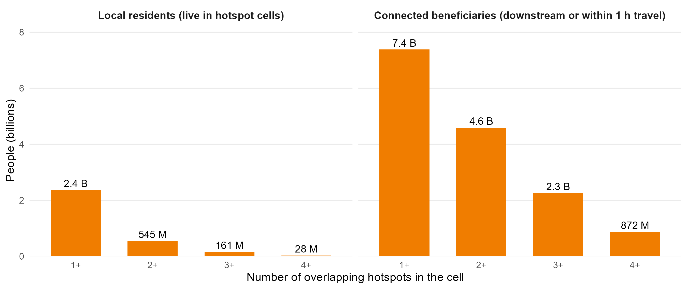{height="300px" fig-align="center"}

::: {style="font-size: 0.72em; max-width: 70%; margin: 0 auto;"}

```{=html}
<div class="stat-row">
  <div class="stat-callout">
    <span class="stat-value">2.4B</span>
    <span class="stat-label">live in a hotspot cell</span>
  </div>
  <div class="stat-callout accent">
    <span class="stat-value">7.4B</span>
    <span class="stat-label">connected downstream or within 1 h travel (92.5% of global population)</span>
  </div>
</div>
```

:::

::: {.notes}
- Off the slide, if asked: connected people per resident 3 (1+ services), 8 (2+), 14 (3+), 31 (4+); connected downstream 5.9 B, travel 7.2 B, either 7.4 B (counted once).
- Ratio: fewer cells and fewer residents as more services overlap (6,897 cells and 28 M residents at 4+), but they still reach 872 M people. Multi-service hotspots are in thinly populated places; most of the impact lands on people elsewhere. Part of the rise is arithmetic (small denominator).
- 7.4 B is the union (either buffer). People reached by both: 5.95 + 7.16 − 7.38 = 5.73 B, so almost everyone downstream is also within an hour's travel.
- Moved off the slide: hotspots cover 13.8% of the evaluated land; low-income countries hold ~13% of the people connected.
- Source: outputs/tables/exposure_by_overlap.csv (scripts/mapping/make_exposure_bars.R).
- Upper-middle-income countries have the most residents in hotspots (919 M); lower-middle-income the most connected beneficiaries (2,675 M).
- Explore: exposure is not impact. "Connected" means within 50 km downstream or 1 h travel of a hotspot; how much of the decline reaches each person is not measured.
- Population is LandScan 2023, applied to 1992-2020 change: a temporal mismatch, acknowledged.
- Numbers updated 10-07 to the current beneficiary run (07-29, five-service hotspots); the earlier 3.1B / 7.6B came from a June run on the old 8-variable hotspots.
:::

# Part 4: Discussion {background-color="#004D1E"}

## The Answer Depends on the Question

::: {style="font-size: 0.8em;"}

| Choice | Example from this analysis |
|:---|:---|
| **Metric** | SPC and absolute change select 32-57% of the same hotspots, depending on the land service |
| **Baseline** | Sediment export: Boreal forests lead in relative terms, tropical moist forests in absolute terms |
| **Grouping** | Lower-middle-income countries lead on land services; coastal risk is over-represented on low-income *and* high-income OECD coasts |
| **Frequency vs severity** | Deserts: few nature access hotspots, but the most severe ones |
| **Scale** | Mean of per-cell change and change of totals can differ in sign for the same region |

: {tbl-colwidths="[18,82]"}

:::

::: {.callout-note style="font-size: 0.78em;"}
None of these answers is wrong; each one answers a different question.
:::

::: {.notes}
- This is the closing message for the findings, and the reason the pipeline matters more than any single number.
- Regional applications (Amazon basin, Southeast Asia, Sub-Saharan Africa) can reuse it with locally calibrated InVEST inputs and a finer grid.
:::

---

## Frequent or Severe: Two Ways to Set Priorities

::: {.columns style="font-size: 0.68em; align-items: flex-start;"}
::: {.column width="50%"}

**Where hotspots of change are frequent**

- Tropical moist forests, Latin America & Caribbean, East Asia & Pacific
- Many hotspot cells, often for several services in the same cell

**Go where the service is lost outright**

- Rare hotspots with deep losses: nature access in deserts
- Fewer cells, but little or nothing is left

:::
::: {.column width="50%"}

**The metric decides who counts**

- SPC: places with a small baseline that lost a large share of it
- Absolute change: productive, populated landscapes, with 2-10× more people

**A "gain" can mean conversion**

- Realized pollination rose where cropland expanded; each variable needs its own reading before it goes into a priority map

:::
:::

::: {.callout-note style="font-size: 0.7em;"}
The data support either logic. Which one to use is a policy choice, and it should be stated.
:::

::: {.notes}
- Pulls together slides on frequency vs severity, metric overlap and pollination: what they mean for anyone using these maps to target action.
- Frequent: relative prevalence > 1 (sediment export in tropical moist forests 3×; LAC 1.9, EAP 1.3 averaged over the land services).
- Outright loss: deserts, nature access hotspots under-represented (0.5) but median −169%, 42% total loss; flooded grasslands both frequent (1.8) and severe (−132%, 34% total loss).
- Caution on "outright loss": where the 1992 level was near zero, a total loss is small in absolute terms (pollination in tropical coniferous forests: the 30% that lost it all had a median of 0.005 people fed/ha in 1992, vs 3.98 for the biome). Total loss means most where the baseline was substantial.
- Metric: SPC-only and absolute-only hotspots differ in 1992 level by 25-1,300× and in residents by 2-10× (hidden backup slide "The Hotspot Set Depends on the Metric"; shown live in the explorer).
:::

---

## Inequality:

::: {style="font-size: 0.72em;"}

```{=html}
<div class="stat-row">
  <div class="stat-callout">
    <span class="stat-value">+0.22–0.30</span>
    <span class="stat-label">Cliff's δ for Gini: land-service hotspots sit in more unequal places</span>
  </div>
  <div class="stat-callout accent">
    <span class="stat-value">~2.3×</span>
    <span class="stat-label">hotspots per unit area, lower-middle-income vs high-income OECD countries</span>
  </div>
  <div class="stat-callout">
    <span class="stat-value">~3 : 1</span>
    <span class="stat-label">connected people per resident: decline reaches people who do not live where it happens</span>
  </div>
</div>
```

:::

::: {.columns style="font-size: 0.7em; align-items: flex-start;"}
::: {.column width="50%"}

**What it does not mean**

- Not a cause: decline and inequality occur together; we did not test why
- Not impact: "connected" means downstream or within 1 h travel; how much of the decline reaches each person is not measured
- Not households: Gini is measured for sub-national administrative units, not for the people in each cell

:::
::: {.column width="50%"}

**Open question**

Why inequality, and not development level or poverty? Candidates: agricultural frontier expansion, land tenure, governance of land conversion. Any of them with a gridded layer can go into the same test

:::
:::

::: {.notes}
- Paper Discussion, second section ("People in More Unequal Places Are More Exposed to Ecosystem Service Decline").
- The inequality signal is small to moderate (δ +0.22 to +0.30) but consistent across the four land services, and it separates them from coastal risk; population and GDP are higher in hotspots of all five services, so they do not separate anything.
- Coastal risk is the exception: higher HDI, and over-represented on both high-income OECD and low-income coasts.
- The three candidates, in plain words:
  - Agricultural frontier expansion: unequal places may be where land is being opened up fastest.
  - Land tenure: who owns and controls land shapes how it gets converted.
  - Governance of land conversion: how well conversion is regulated.
- Next step the pipeline supports: add a gridded layer for a candidate (e.g. deforestation or cropland expansion for the frontier) to the same KS / Cliff's δ test. That shows whether it also separates hotspots, still as co-occurrence. Explaining why needs more than that: case comparisons or causal designs.
- Data limits: land tenure and governance mostly exist per country, not as grids; they can be joined to cells but add no sub-national detail.
- Robustness to check first: the Gini signal may be driven by a few large unequal regions (many cells share one sub-national value), e.g. in Latin America.
- Testing mechanisms would need sub-national tenure and governance data or case comparisons; future work.
- Gini layer: subnational (admin-1) Gini of disposable income, 2020; source citation still to confirm.
:::

---

## What the Analysis Cannot Say Yet

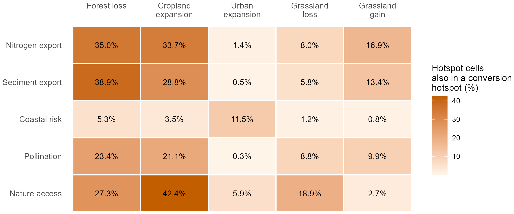{height="340px" fig-align="center"}

::: {.columns style="align-items: flex-start;"}
::: {.column width="58%" .fs56}

**Why the change happened: tried, not conclusive**

- We overlaid service hotspots on land cover conversion hotspots, cell by cell
- 63% of service hotspots had no intense conversion in the same cell; part of the rest is regional co-location
- The models move effects downstream and over foraging or travel distance, which a same-cell overlay cannot see
- Next: count conversion in neighbouring cells; rerun the models holding land cover or climate fixed

:::
::: {.column width="42%" .fs56}

**Other limits**

- Global models without local calibration
- 10 km cells: regional patterns, not sites
- Two snapshots (next: more time points)
- 2023 population on 1992-2020 change

:::
:::

::: {.notes}
- The driver result is narrow: hotspot cells of service change compared with hotspot cells of intense land cover conversion (top 5% per driver), in the same 10 km cell. It does not say land cover change is unrelated to service change in general.
- "Flow paths" means effects accumulate in downstream cells (sediment, nitrogen); it is about where the change appears, not about downstream users.
- This is what remains of the land cover attribution analysis (the former WHY question). It was dropped as a research question on 10-05 and kept as exploratory in the paper's Supplement. Not a causal partition.
- Null model behind "regional co-location": shuffling hotspots at random within blocks of decreasing size, the overlap expected by chance rises from 9% (global) to 25% (0.5° blocks).
- Climate inputs: if the 1992 and 2020 SDR/NDR runs used different climate, export could change with no land cover change. Open question to the model authors.
- Ask the lab: how would you attribute change that the models themselves propagate along flow paths?
:::

# Part 5: Conclusions {background-color="#004D1E"}

## Synthesis

::: {style="font-size: 0.7em;"}

| Question | Finding | Implication |
|:---|:---|:---|
| **WHAT** | N and sediment export rose (+1.6%, +1.4%), nature access fell (−8.7%, in every biome and region), pollination rose (+6.9%) partly through cropland expansion | Global averages hide opposite stories; each variable needs its own reading |
| **WHERE** | 189,932 hotspot cells, clustered in Latin America & Caribbean (1.9×) and East Asia & Pacific (1.3×); frequency and severity point to different places | Two prioritization logics: frequent hotspots vs rare total losses |
| **WHO** | ~2.3× as frequent per unit area in lower-middle-income countries; land-service hotspots in more unequal places (Gini δ +0.22 to +0.30); 2.4B residents, 7.4B connected | Inequality, not only income level, marks where exposure concentrates |
| **HOW** | Results move with metric, baseline, grouping and scale; the pipeline makes each choice explicit | Report sensitivity, not a single number; reuse the pipeline for regional questions |

: {tbl-colwidths="[10,52,38]"}

:::

---

## Asking Your Own Question: The Change Explorer

::: {.columns style="font-size: 0.72em; align-items: flex-start;"}
::: {.column width="50%"}
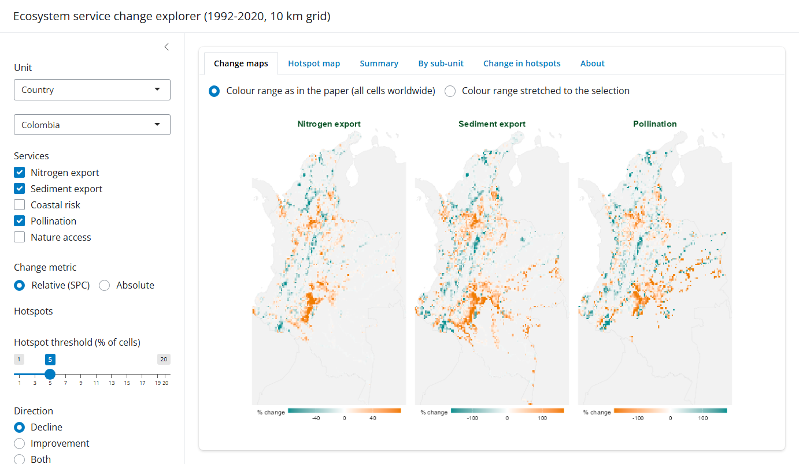{height="330px"}
:::
::: {.column width="50%"}
{height="330px"}
:::
:::

::: {style="font-size: 0.6em;"}
- Any country, World Bank region, biome or income group; any subset of the five services
- Relative or absolute change; hotspot threshold, direction (decline or improvement) and reference (local or global)
- Prevalence by sub-unit, change within hotspots, people living in hotspots, cell download
- A prototype built on this repository's outputs: ideas for what it should show are welcome
:::

::: {.notes}
- Context: if the answer depends on the question (metric, baseline, grouping, scale), users need a way to make those choices themselves. The explorer exposes them as inputs.
- Live demo if time allows (run from PowerShell before the talk: `Rscript -e "options(browser = 'C:/Program Files/Google/Chrome/Application/chrome.exe'); shiny::runApp('scripts/dashboard', port = 4683, launch.browser = TRUE)"` (opens in Chrome), or open http://127.0.0.1:4683 in Chrome by hand; the whole-world view takes ~15 s the first time). Screenshots are the fallback.
- Suggested demo: switch the reference from local to global (5% decline, all services, SPC). Share of cells in a hotspot of at least one service: Brazil 12.1% local vs 26.3% global (its extremes are the world's extremes); Germany 13.6% vs 6.8%; Colombia 12.5% vs 14.8%.
- Second demo, for the metric: Colombia (or the world), sediment export only, switch Relative (SPC) to Absolute. Checked on the explorer data (Colombia's own top 5%, 569 cells): SPC hotspots sit further south (median latitude 2.3°N, the Andes-Amazon foothills and the deforestation frontier) and started from little export (median 1992 level ~25); absolute hotspots sit in the central Andes (median 5.9°N), where export was ~1,000× higher. Only 19% of cells are shared. Worldwide, 32-57% of hotspots are shared between the two metrics depending on the service (backup slide, hidden).
- Main point: it took a few days, not a project, because the pipeline outputs (the 10 km change grid and the native-pixel tables) already exist. I am not a web designer; the value is in the data behind it.
- Limits: local residents only. Connected beneficiaries (downstream, travel time) exist only for the global 5% decline set; other scenarios would need a new beneficiary run.
- Could be hosted (e.g. Posit Connect Cloud) if it would be useful to others.
:::

---

## Where I Would Like Your Input

::: {style="font-size: 0.8em;"}

1. **Who is connected:** should each service use its own pathway (downstream for water, travel time for access), or both pathways for every hotspot?
2. **Drivers:** were the 1992 and 2020 sediment and nitrogen runs made with the same climate inputs? How would you separate land cover from climate when the models carry change downstream?
3. **Inequality:** which sub-national data could test frontier expansion, land tenure or governance?
4. **Use:** what question would you ask the explorer, and for which place?

:::

::: {.notes}
- Leave ~5 minutes. These are open choices where the lab's view changes what goes into the paper; ask for one or two, not all four.
- Q1: the headline 7.4 B applies both pathways to every hotspot; the paper's Methods describes one pathway per service. Service-specific runs exist (water hotspots downstream 3.1 B; access hotspots by travel 7.05 B). Settling which is right decides the paper's numbers.
- Q2: if the climate inputs differ between the two years, part of the export change is climate, not land cover. Options already in mind: count conversion in neighbouring cells (distance decay); rerun holding land cover or climate fixed.
- Q3: Gini is sub-national; tenure and governance mostly exist per country. Any gridded layer can go into the same KS / Cliff's δ test.
- Q4: invite people to try the explorer after the talk; collect ideas.
:::

---

## Status {visibility="hidden"}

::: {.columns style="font-size: 0.7em;"}
::: {.column width="50%"}

**Done**

- Paper draft revised and shared for PI review (October 2026)
- Five-service hotspot definition (export and risk), SPC as the primary metric
- Coastal risk prevalence measured against coastal cells
- Frequency vs severity of hotspots by biome, region and income group
- Metric sensitivity and null models for co-occurrence

:::

::: {.column width="50%"}

**Open**

- Climate inputs for the 1992 vs 2020 SDR/NDR runs (same or era-specific?)
- Every paper number traced to data by a verification script
- Driver attribution (distance-decay, fixed-input reruns): future work
- Hand-off: runbook, data documentation, regional worked example

:::
:::

# Questions? {background-color="#004D1E"}

- Contact: Jerónimo Rodríguez Escobar (jeronimo.rodriguez@wwfus.org)
- Code: [github.com/springinnovate/global_NCP](https://github.com/springinnovate/global_NCP)

---

## Appendix: Reading SPC Values

::: {.columns style="font-size: 0.75em; align-items: flex-start;"}
::: {.column width="55%"}

| SPC | 2020 ÷ 1992 | In words |
|---:|---:|:---|
| −200% | 0 | fell to zero |
| −169% | 0.08 | lost over 90% |
| −102% | 0.32 | lost about two thirds |
| −67% | 0.5 | halved |
| 0 | 1 | no change |
| +40% | 1.5 | up by half |
| +67% | 2 | doubled |
| +100% | 3 | tripled |
| +124% | 4.3 | about four times |
| +200% | | appeared from zero |

:::
::: {.column width="45%"}

Ratio between the years: (200 + SPC) ÷ (200 − SPC)

Example: 10 t in 1992, 43 t in 2020

- SPC = 200 × 33 ÷ 53 = +124%
- 2020 ÷ 1992 = 4.3
- Ordinary change = +330%

Close to ordinary % change up to about ±40; compressed beyond that.

:::
:::

::: {.notes}
- Same formula as on the methods slide: change divided by the mean of the two years, × 100, is 200 × (2020 − 1992) ÷ (2020 + 1992).
- +100% SPC is tripled, not doubled. The scale stops at ±200%.
:::

---

## Appendix: Within-Hotspot Change by Region

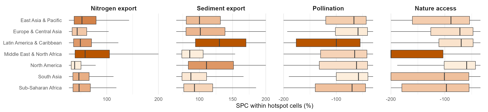{width="100%" fig-align="center"}

::: {.notes}
- Middle East & North Africa: half of the nature access hotspots (51%) lost access entirely (median −200%).
- Latin America & Caribbean: the most severe pollination and sediment export hotspots (medians −99% and +130%).
:::

---

## Appendix: Technical Methods — Key Decisions

::: {.columns style="font-size: 0.74em; align-items: flex-start;"}
::: {.column width="50%"}

### Spatial standardisation
- InVEST rasters are in **WGS84** — pixel area varies with latitude
- **Volumetric services** (N export, Sed export): pre-normalised to **per hectare** before extraction, correcting for latitude-dependent pixel size
- **Already per-area or index values** (pollination in people fed/ha, nature access, retention ratios): no correction; an area correction would introduce spurious latitudinal gradients
- **Coastal risk** (`C_Risk` = `Rt`): exposure index at shoreline points, averaged to the grid; not an area-based quantity

:::
::: {.column width="50%"}

### Aggregation at the grid-cell level
- All ES rasters extracted to 10km grid using **mean** (not sum)
- Rasters are already per-ha → mean gives a valid, comparable per-ha rate across equal-area cells
- For hotspot detection: SPC(mean, mean) = SPC(sum, sum) for equal-area cells — rankings are identical regardless of choice
- **Socioeconomic variables** (Population, GDP) use **sum** — these are absolute counts/totals, a different interpretation

### Equal-area grid
- IUCN AOO 10km grid uses an **equal-area projection**, not lat/lon
- Every cell = exactly 100 km² regardless of latitude
- Makes cross-regional comparisons valid without polar distortion

:::
:::

::: {.notes}
- This slide is a Q&A backup — not shown in the main flow.
- The per-hectare correction question comes up because InVEST runs in WGS84 for most services. The key point: correction was applied where it's meaningful (absolute quantities), not applied where it would distort (dimensionless values).
- The mean vs sum question: pragmatically, it doesn't affect hotspot results because SPC normalizes the values. The choice matters more for interpretability of the grid-cell values.
- Equal-area point: a standard lat/lon grid at 10 arc-minutes has cells ~50% smaller at 60°N than at the equator — that would bias hotspot counts toward the tropics by area alone.
:::

---

## Appendix: Implementation

::: {.columns style="font-size: 0.66em; align-items: flex-start;"}
::: {.column width="55%"}

| Step | Tool |
|:---|:---|
| 1992 to 2020 change rasters, per-hectare conversion | Python (GDAL, rasterio) |
| Path A: zonal statistics to grouping polygons | `zonal_stats_toolkit` (Python, Docker), .ini configs |
| Path B: zonal statistics to the 10 km grid | `summary_pipeline_landgrid.py` (Python, exactextract, Docker), YAML configs |
| Change, hotspots, prevalence, KS tests | R / Quarto notebooks in `analysis/`, functions in `R/` |
| Serviceshed routing (downstream, travel time) | workflow runner (Python, YAML), run by Rich Sharp |
| Figures and the change explorer | R scripts in `scripts/mapping/`, R Shiny in `scripts/dashboard/` |

:::
::: {.column width="45%"}

Services, dates, groupings and thresholds are set in config files, not in code.

The heavy raster work runs in Docker images, so it runs the same on any machine.

Open work: one service config shared by every step (now repeated across notebooks), a single script chain in place of the notebooks, and alignment with the NatCap TEEMs code base.

Code: github.com/springinnovate/global_NCP

:::
:::

::: {.notes}
- Q&A backup. Order of the R chain: process_data → hotspot_extraction → hotspot_synthesis → KS_tests_hotspots; `analysis/rebuild_hotspot_area_stats.R` currently replaces part of the synthesis step (coastal denominator fix).
- Path B extraction: about 15-20 minutes per config for the 1.52 M-cell grid (runbook, Step 0).
- Repository: `analysis/` notebooks, `R/` functions and the service config (`service_config.R`), `scripts/mapping/` figures, `analysis_configs/` pipeline configs, `docs/` paper, book, runbook and this deck.
:::

---

## Appendix: Methodology References

::: {.columns style="font-size: 0.72em;"}
::: {.column width="50%"}

### Data & Tools
- **InVEST**: Sharp et al. (2020) — Natural Capital Project biophysical models
- **exactextract**: Fast raster zonal statistics (Python)
- **ESA CCI / C3S**: Land cover classification from satellite data (1992–2020)
- **Quarto + R**: Reproducible analysis and reporting

:::
::: {.column width="50%"}

### Key Publications & Methods
- Chaplin-Kramer et al. (2019) *Science*: global NCP baseline — this paper extends it
- Chaplin-Kramer et al. (2023) *Nature Ecology & Evolution*: critical natural assets
- Brauman et al. (2020) *PNAS*; IPBES (2019); Millennium Ecosystem Assessment (2005): global trends in nature's contributions
- Kim et al. (2024) *Science*; Peng et al. (2023) *J. Cleaner Production*: closest global trend studies
- Socioeconomic layers: Schiavina et al. (2023) GHS-POP; Kummu et al. (2025) *Sci. Data* GDP; Sherman et al. (2026) *Nat. Commun.* HDI; Mehrabi et al. (2021) *Nat. Sustain.* field size; ORNL (2024) LandScan 2023
- Cliff (1993): Cliff's Delta effect size for ordinal data
- Benjamini & Hochberg (1995): false discovery rate correction
- Andam et al. (2008): ecosystem service spillover effects
- Kolmogorov & Smirnov: non-parametric distribution comparison

:::
:::
