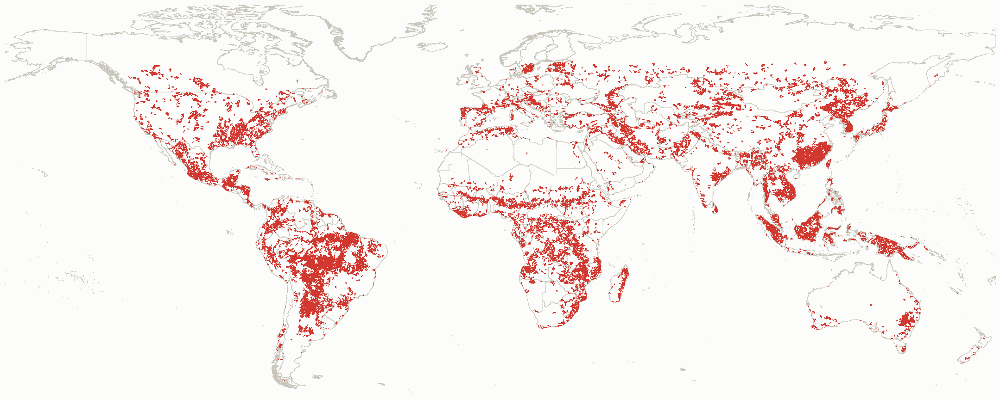
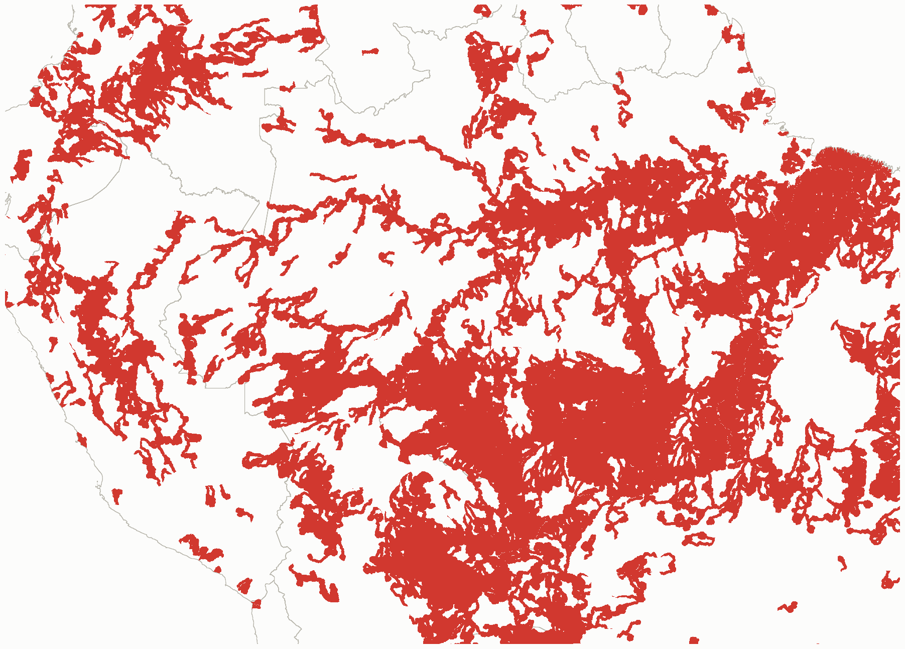
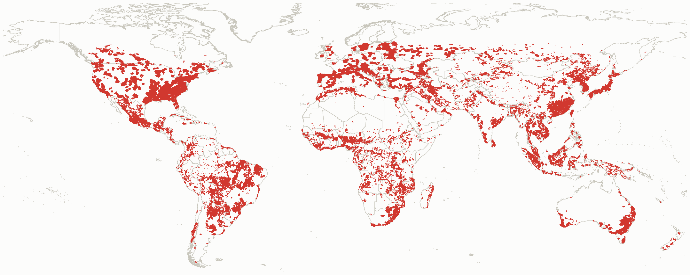
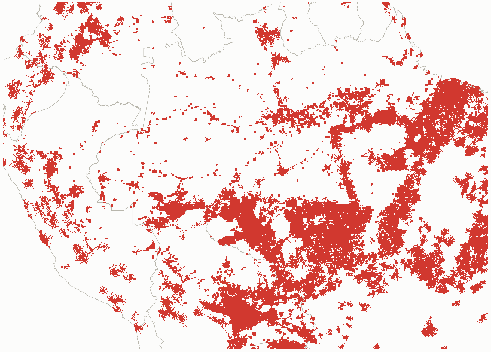
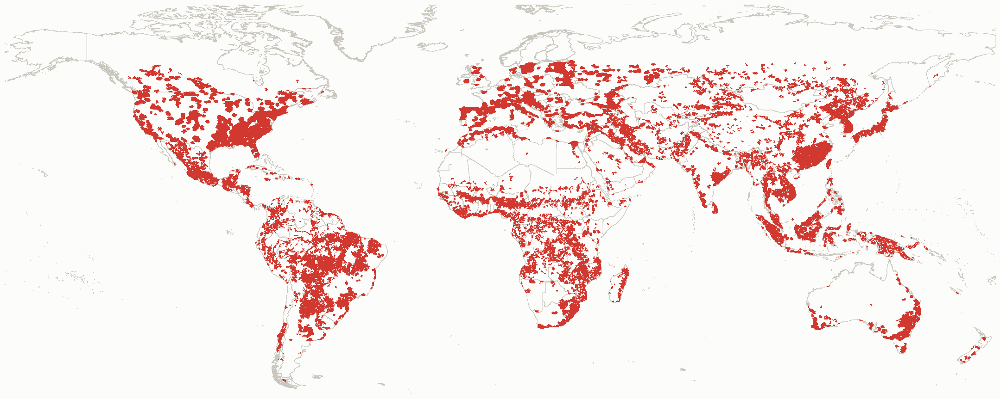
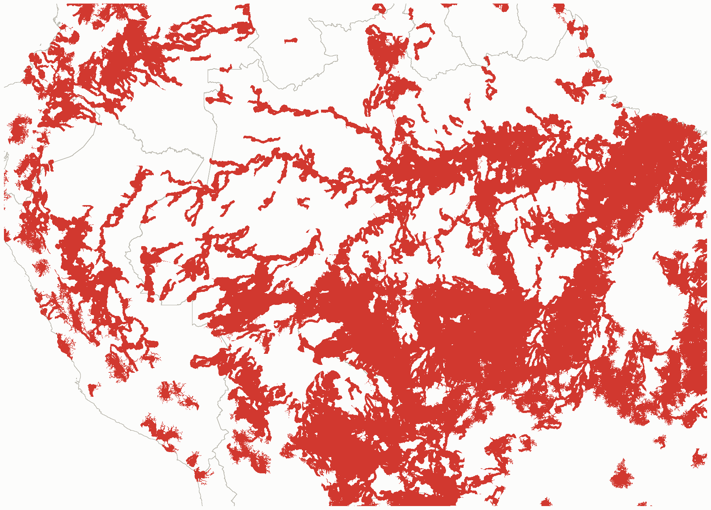
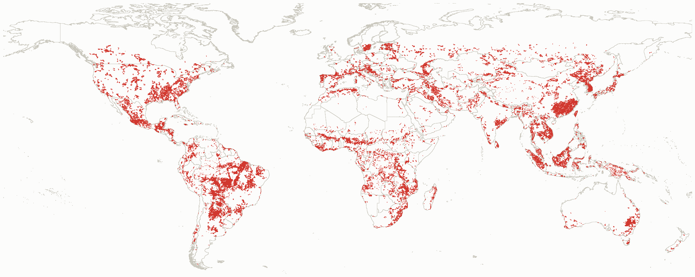
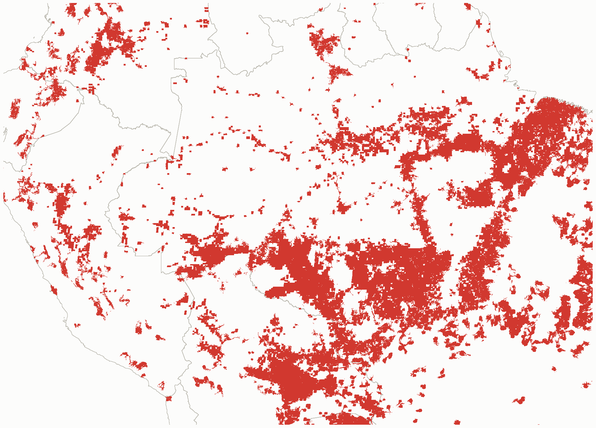

```{r}
#| label: setup
library(dplyr)
library(readr)
library(purrr)

tab_dir <- here::here("outputs", "tables")
cells   <- read_csv(file.path(tab_dir, "beneficiary_masks", "cells.csv"), show_col_types = FALSE)
people  <- read_csv(file.path(tab_dir, "beneficiary_masks", "people.csv"), show_col_types = FALSE)
strata  <- read_csv(file.path(tab_dir, "beneficiary_masks", "strata.csv"), show_col_types = FALSE)
checks  <- read_csv(file.path(tab_dir, "beneficiary_masks", "checks.csv"), show_col_types = FALSE)
by_reg  <- read_csv(file.path(tab_dir, "beneficiary_masks", "by_region.csv"), show_col_types = FALSE)
lac_gini <- by_reg$gini_median[by_reg$mask == "tier_1plus" & by_reg$region_wb == "Latin America & Caribbean"]
landscan_pct <- read_csv(file.path(tab_dir, "exposure_by_overlap.csv"), show_col_types = FALSE) |>
  filter(level == "1+") |> pull(pct_world)
hot     <- read_csv(file.path(tab_dir, "ks_hotspots_stratified.csv"), show_col_types = FALSE) |>
  filter(var != "gini") |> mutate(var = if_else(var == "gini_clean", "gini", var))

# number formatting: signed deltas with a true minus sign
d2  <- function(x) gsub("-", "−", sprintf("%+.2f", x))
rng <- function(x) paste0(d2(min(x)), " to ", d2(max(x)))
pct <- function(x, k = 1) paste0(formatC(x, format = "f", digits = k), "%")
num <- function(x) formatC(x, format = "d", big.mark = ",")

cv <- function(m, v, col = "delta") cells[[col]][cells$mask %in% m & cells$var %in% v]
st <- function(m, v, col) strata[[col]][strata$mask %in% m & strata$var %in% v]
pp <- function(m, v, col) people[[col]][people$mask %in% m & people$var %in% v]
ck <- function(i) checks$value[i]

tiers <- c("tier_1plus", "tier_2plus", "tier_3plus", "tier_4plus")
land_hot <- c("N_export", "Sed_export", "Pollination", "Nature_Access")
hv <- function(s, v, col) hot[[col]][hot$service %in% s & hot$var %in% v]

mask_label <- c(tier_1plus = "1+ services", tier_2plus = "2+ services", tier_3plus = "3+ services",
                tier_4plus = "4+ services", combined_cross = "Water + access in one cell",
                water = "Water hotspots, downstream", access = "Access hotspots, travel time")
svc_label <- c(N_export = "Nitrogen export", Sed_export = "Sediment export", Pollination = "Pollination",
               Nature_Access = "Nature access", C_Risk = "Coastal risk")
var_label <- c(pop = "Population", gdp = "GDP (total)", gdp_pc = "GDP per capita", hdi = "HDI", gini = "Gini")

# ---- inline SVG dot charts (CSS colour tokens, so light/dark follow the page) ----------------
# d: rows with group, label, series, value, tip. Rows keep their order of appearance.
svg_dots <- function(d, series_css, xlim, lollipop = FALSE, label_w = 200, plot_w = 500,
                     row_h = 22, head_h = 34, aria = "") {
  sx <- function(v) label_w + (v - xlim[1]) / diff(xlim) * plot_w
  rows <- distinct(d, group, label)
  y <- 6; out <- character(); prev_group <- NULL
  for (i in seq_len(nrow(rows))) {
    g <- rows$group[i]
    if (!identical(g, prev_group) && !is.na(g) && nzchar(g)) {
      y <- y + if (is.null(prev_group)) 14 else head_h
      out <- c(out, sprintf('<text x="0" y="%.1f" class="grp-label">%s</text>', y, g))
      y <- y - 2
    }
    prev_group <- g
    y <- y + row_h
    r <- filter(d, group == g | (is.na(group) & is.na(g)), label == rows$label[i])
    out <- c(out, sprintf('<text x="%d" y="%.1f" class="bar-label">%s</text>',
                          if (is.na(g) || !nzchar(g)) 0 else 10, y + 4, rows$label[i]))
    v <- r$value[is.finite(r$value)]
    if (lollipop && length(v)) {
      out <- c(out, sprintf('<line x1="%.1f" x2="%.1f" y1="%.1f" y2="%.1f" stroke="var(--baseline)" stroke-width="2"/>',
                            sx(0), sx(v[1]), y, y))
    } else if (length(v) > 1) {
      out <- c(out, sprintf('<line x1="%.1f" x2="%.1f" y1="%.1f" y2="%.1f" stroke="var(--baseline)" stroke-width="2"/>',
                            sx(min(v)), sx(max(v)), y, y))
    }
    for (j in seq_len(nrow(r))) if (is.finite(r$value[j])) {
      out <- c(out, sprintf(
        '<g><title>%s</title><circle cx="%.1f" cy="%.1f" r="10" fill="transparent"/><circle cx="%.1f" cy="%.1f" r="5" fill="var(%s)" stroke="var(--surface)" stroke-width="2"/></g>',
        r$tip[j], sx(r$value[j]), y, sx(r$value[j]), y, series_css[[r$series[j]]]))
    }
  }
  h <- y + 30
  refs <- c(-0.47, -0.33, -0.15, 0.15, 0.33, 0.47)
  refs <- refs[refs > xlim[1] & refs < xlim[2]]
  grid_lines <- c(
    sprintf('<line x1="%.1f" x2="%.1f" y1="4" y2="%.1f" stroke="var(--band-tick)" stroke-width="1" stroke-dasharray="2,3"/>',
            sx(refs), sx(refs), h - 22),
    sprintf('<line x1="%.1f" x2="%.1f" y1="4" y2="%.1f" stroke="var(--baseline)" stroke-width="1.5"/>', sx(0), sx(0), h - 22))
  ticks <- seq(ceiling(xlim[1] * 5) / 5, floor(xlim[2] * 5) / 5, by = 0.2)
  axis <- sprintf('<text x="%.1f" y="%.1f" class="axis-label" text-anchor="middle">%s</text>',
                  sx(ticks), h - 6, gsub("-", "−", sprintf("%.1f", ticks)))
  sprintf('<svg viewBox="0 0 %d %.0f" width="100%%" role="img" aria-label="%s">%s</svg>',
          label_w + plot_w + 12, h, aria, paste(c(grid_lines, out, axis), collapse = ""))
}
legend_html <- function(series_css, extra = NULL) {
  items <- sprintf('<div class="item"><span class="swatch" style="background:var(%s)"></span>%s</div>',
                   unname(series_css), names(series_css))
  paste0('<div class="chart-legend">', paste(c(items, extra), collapse = ""), '</div>')
}
thr_note <- '<div class="item" style="color:var(--muted)">Dashed: ±0.15 / 0.33 / 0.47 (small / medium / large)</div>'
```

<div class="eyebrow">Global NCP Hotspot Analysis · Memo</div>
<div class="meta">
  <span>Prepared by Jerónimo Rodríguez Escobar</span>
  <span>Global Science, WWF</span>
</div>

## Key findings

::: {.findings}
::: {.finding}
**Places.** Serviceshed land is populated land: population and total GDP are far higher inside the masks than outside (δ `r rng(cv(tiers, "pop"))`). Per person it is not richer or more developed: GDP per capita δ `r rng(cv(tiers, "gdp_pc"))`, HDI δ `r rng(cv(tiers, "hdi"))` across the overlap tiers.
:::
::: {.finding}
**Inequality.** Serviceshed land sits in more unequal places (Gini δ `r d2(cv("tier_1plus", "gini"))` at 1+, rising to `r d2(cv("tier_4plus", "gini"))` at 4+), but this is a between-country pattern. Within countries δ is `r rng(st(c(tiers[c(1,3,4)], "combined_cross"), "gini", "within_country_cells"))`: the masks fall in high-inequality countries, mostly in Latin America, not in the more unequal provinces of each country.
:::
::: {.finding}
**People.** Counted by people instead of land, the `r pct(pp("tier_1plus", "hdi", "pct_pop_in"), 0)` of the world population connected to at least one hotspot is better off than the rest (HDI δ `r d2(pp("tier_1plus", "hdi", "delta_people"))`, GDP per capita δ `r d2(pp("tier_1plus", "gdp_pc", "delta_people"))`) and lives in slightly less unequal places (Gini δ `r d2(pp("tier_1plus", "gini", "delta_people"))`). The people left out are mostly remote rural populations beyond the 1 h travel reach.
:::
::: {.finding}
**The paper's socioeconomic test.** The same decomposition applies to the hotspot cells in the WHO section: Gini δ `r rng(hv(land_hot, "gini", "pooled"))` for the four land services pooled, `r rng(hv(land_hot, "gini", "within_country"))` within countries. Within countries, nitrogen export, nature access and pollination hotspots sit in the more developed regions (HDI δ `r rng(hv(c("N_export", "Nature_Access", "Pollination"), "hdi", "within_country"))`).
:::
:::

## Data and method

| | |
|---|---|
| **Masks** | Land within 50 km downstream (river network) or 1 h travel (2019 friction surface) of hotspot cells, from the 2026-07-29 beneficiary run (LandScan 2023). Its input hotspots match the production set (189,918 of 189,932 cells). |
| **Categories** | Overlap tiers 1+ to 4+ (hotspot for at least *k* of the five services, both pathways), water and access hotspot in the same cell (both pathways), and two service-specific masks: water hotspots routed downstream only, access hotspots (nature access, pollination, coastal risk) by travel time only. The 5-service tier (about 0.03% of land) is too small to profile. |
| **Grid** | The `r num(1372621)` evaluated 10 km cells. A cell is inside a mask when at least half of its area is covered. |
| **Variables** | Population (GHS-POP 2020, cell sum), GDP 2020 (Kummu et al. 2025, cell total), GDP per capita (GDP / GHS-POP, cells with at least one person), HDI 2020 (Sherman et al. 2026), sub-national Gini of disposable income 2020 (source to confirm). |
| **Places** | Two-sample KS test and Cliff's δ, inside vs outside: δ = P(inside cell higher) − P(inside cell lower). Thresholds 0.15 / 0.33 / 0.47 (Romano et al. 2006). All BH-adjusted KS p-values are below 10^−250^. |
| **People** | The same δ with every cell weighted by its population: a random person inside a mask compared with a random person outside it. |
| **Geography** | δ computed within each World Bank region or each country and combined with weights *n*~inside~ × *n*~outside~ (the pairs each stratum contributes). A pooled δ that vanishes within countries comes from which countries the cells are in. |

: {.terms tbl-colwidths="[22,78]"}

```{=html}
<div class="map-tabs">
  <input type="radio" name="masktab" id="tab-ds" checked>
  <input type="radio" name="masktab" id="tab-tt">
  <input type="radio" name="masktab" id="tab-un">
  <input type="radio" name="masktab" id="tab-in">
  <div class="tab-labels">
    <label for="tab-ds">Downstream (50 km)</label>
    <label for="tab-tt">Travel time (1 h)</label>
    <label for="tab-un">Union (either)</label>
    <label for="tab-in">Intersection (both)</label>
  </div>
  <div class="panels">
    <div class="tab-panel panel-ds">
      <div class="map-card"></div>
      <div class="map-card"></div>
    </div>
    <div class="tab-panel panel-tt">
      <div class="map-card"></div>
      <div class="map-card"></div>
    </div>
    <div class="tab-panel panel-un">
      <div class="map-card"></div>
      <div class="map-card"></div>
    </div>
    <div class="tab-panel panel-in">
      <div class="map-card"></div>
      <div class="map-card"></div>
    </div>
  </div>
</div>
<p class="map-caption">Mask for cells with both a water and an access hotspot, at the source resolution (30 arcsec). Global extent decimated for display; inset at native resolution.</p>
```

The masks are large. The 1+ mask covers `r pct(pp("tier_1plus", "hdi", "pct_cells_in"), 0)` of the evaluated land and `r pct(pp("tier_1plus", "hdi", "pct_pop_in"), 1)` of GHS-POP (`r pct(landscan_pct, 1)` of LandScan in the exposure count); the 4+ mask covers `r pct(pp("tier_4plus", "hdi", "pct_cells_in"), 1)` of the land and `r pct(pp("tier_4plus", "hdi", "pct_pop_in"), 1)` of the people.

## 1. Which places the servicesheds cover

```{r}
#| results: asis
tier_css <- c("1+ services" = "--o1", "2+ services" = "--o2", "3+ services" = "--o3", "4+ services" = "--o4")
d1 <- cells |>
  filter(mask %in% tiers, var %in% c("pop", "gdp", "gdp_pc", "hdi", "gini")) |>
  mutate(group = var_label[var], label = mask_label[mask], series = label, value = delta,
         tip = sprintf("%s, %s: δ = %s (median inside %s, outside %s)", group, label, d2(delta),
                       signif(median_in, 3), signif(median_out, 3))) |>
  arrange(match(var, c("pop", "gdp", "gdp_pc", "hdi", "gini")), mask)
cat('<div class="chart-card">',
    svg_dots(d1, tier_css, xlim = c(-0.2, 0.7), lollipop = TRUE,
             aria = "Cliff's delta inside vs outside the serviceshed masks, by variable and overlap tier"),
    legend_html(tier_css, thr_note), '</div>', sep = "")
```

Population and total GDP separate the masks from the rest of the land (δ about 0.5), largely by construction: the travel pathway follows roads and settlements, and the empty land of deserts, boreal forest and the interior Amazon falls outside. Total GDP adds nothing beyond population. Once divided by population, GDP barely differs (median per capita `r paste0("$", formatC(cv("tier_1plus", "gdp_pc", "median_in"), format = "d", big.mark = ","))` inside the 1+ mask, `r paste0("$", formatC(cv("tier_1plus", "gdp_pc", "median_out"), format = "d", big.mark = ","))` outside), and neither does HDI. Gini is the one variable that rises with the overlap tier.

## 2. The inequality signal is between countries

```{r}
#| results: asis
geo_css <- c("Pooled" = "--s1", "Within WB region" = "--s2", "Within country" = "--s3")
geo_long <- function(v) {
  h <- hot |> filter(var == v) |>
    transmute(group = "Hotspot cells (paper, WHO section)", label = svc_label[service],
              pooled, within_region, within_country)
  m <- strata |> filter(var == v, mask %in% c("tier_1plus", "tier_3plus", "tier_4plus", "combined_cross")) |>
    transmute(group = "Serviceshed masks", label = mask_label[mask],
              pooled = pooled_cells, within_region = within_region_cells, within_country = within_country_cells)
  bind_rows(h, m) |>
    tidyr::pivot_longer(c(pooled, within_region, within_country), names_to = "k", values_to = "value") |>
    mutate(series = c(pooled = "Pooled", within_region = "Within WB region", within_country = "Within country")[k],
           tip = sprintf("%s, %s: %s δ = %s", label, toupper(v), tolower(series), d2(value)))
}
for (v in c("gini", "hdi")) {
  cat('<div class="chart-card"><div class="panel-title">', c(gini = "Gini", hdi = "HDI")[v],
      '</div><div class="panel-sub">Cliff\'s δ, hotspot or mask cells vs background cells</div>',
      svg_dots(geo_long(v), geo_css, xlim = c(-0.3, 0.4),
               aria = paste(toupper(v), "Cliff's delta pooled, within region and within country")),
      legend_html(geo_css, thr_note), '</div>', sep = "")
}
```

Within a country, the Gini layer varies only between sub-national units, so the within-country δ asks whether hotspots and servicesheds fall in the more unequal provinces of their own country. They do not: δ is near zero or negative for every service and mask. The pooled signal comes from where the cells are on the world map. Latin America, the region with the highest sub-national Gini (median `r sprintf("%.2f", lac_gini)` on the grid), holds `r pct(hv("Sed_export", "gini", "pct_hot_in_lac"), 0)` of sediment export hotspots, `r pct(hv("Pollination", "gini", "pct_hot_in_lac"), 0)` of pollination, `r pct(hv("N_export", "gini", "pct_hot_in_lac"), 0)` of nitrogen export and `r pct(hv("Nature_Access", "gini", "pct_hot_in_lac"), 0)` of nature access hotspots, against `r pct(min(hv(land_hot, "gini", "pct_bg_in_lac")), 0)` to `r pct(max(hv(land_hot, "gini", "pct_bg_in_lac")), 0)` of the background cells. Within World Bank regions part of the signal remains (other high-Gini countries within each region), within countries it does not.

HDI shows the reverse. Pooled, the land-service hotspots lean slightly toward less developed places (δ `r rng(hv(land_hot, "hdi", "pooled"))`); within countries nitrogen export, nature access and pollination hotspots sit in the more developed regions (δ `r rng(hv(c("N_export", "Nature_Access", "Pollination"), "hdi", "within_country"))`; sediment export `r d2(hv("Sed_export", "hdi", "within_country"))`). Hotspots concentrate in middle-income countries, and inside those countries in their more developed, more accessible regions.

The 4+ mask keeps a small residual: within-country Gini δ `r d2(st("tier_4plus", "gini", "within_country_cells"))`, and `r d2(st("tier_4plus", "gini", "admin_units_delta"))` when each sub-national Gini unit is counted once (`r num(st("tier_4plus", "gini", "n_admin_units"))` units). Both are below the 0.15 threshold.

## 3. Which people are connected

```{r}
#| results: asis
pc_css <- c("Land cells" = "--s1", "People" = "--s2")
d3 <- strata |>
  filter(var %in% c("gdp_pc", "hdi", "gini"), mask %in% names(mask_label)) |>
  transmute(group = var_label[var], label = mask_label[mask], var, mask,
            `Land cells` = pooled_cells, People = pooled_people) |>
  tidyr::pivot_longer(c(`Land cells`, People), names_to = "series", values_to = "value") |>
  mutate(tip = sprintf("%s, %s: δ = %s (%s)", group, label, d2(value), tolower(series))) |>
  arrange(match(var, c("gdp_pc", "hdi", "gini")),
          match(mask, c("tier_1plus", "tier_3plus", "tier_4plus", "combined_cross", "water", "access")))
cat('<div class="chart-card">',
    svg_dots(d3, pc_css, xlim = c(-0.3, 0.5),
             aria = "Cliff's delta by land cell and by person, inside vs outside each mask"),
    legend_html(pc_css, thr_note), '</div>', sep = "")
```

Weighting by population changes the comparison from land to people, and the answer changes with it. The people inside the masks have higher HDI and GDP per capita than the people outside, and Gini drops to near zero or below. The weighted δ holds within countries too (HDI `r d2(st("tier_1plus", "hdi", "within_country_people"))`, GDP per capita `r d2(st("tier_1plus", "gdp_pc", "within_country_people"))` at 1+), so it is an accessibility gradient inside countries, not a rich-country effect. The water mask, which follows rivers rather than roads, shows the weakest gradient.

```{r}
#| results: asis
fmt_money <- function(x) paste0("$", formatC(round(x, -2), format = "d", big.mark = ","))
tb <- people |>
  filter(mask %in% c("tier_1plus", "tier_3plus", "tier_4plus", "combined_cross", "water", "access")) |>
  select(mask, var, pct_pop_in, wmedian_in, wmedian_out, delta_people) |>
  tidyr::pivot_wider(names_from = var, values_from = c(wmedian_in, wmedian_out, delta_people)) |>
  arrange(match(mask, c("tier_1plus", "tier_3plus", "tier_4plus", "combined_cross", "water", "access"))) |>
  transmute(Mask = mask_label[mask], `People inside` = pct(pct_pop_in),
            `GDP per capita, inside / outside` = paste(fmt_money(wmedian_in_gdp_pc), "/", fmt_money(wmedian_out_gdp_pc)),
            `HDI, inside / outside` = sprintf("%.3f / %.3f", wmedian_in_hdi, wmedian_out_hdi),
            `Gini, inside / outside` = sprintf("%.3f / %.3f", wmedian_in_gini, wmedian_out_gini))
cat(knitr::kable(tb, format = "html", table.attr = 'class="results"', escape = FALSE,
                 caption = "Population-weighted medians (the value for the median person), GHS-POP 2020."), sep = "")
```

## 4. Robustness

**Union vs intersection.** Requiring both pathways (intersection) instead of either (union) shrinks the masks to about 40% of their area. The δ values barely move:

```{r}
#| results: asis
ui <- cells |>
  filter(mask %in% c("combined_cross", "tier_3plus", "tier_4plus",
                     "combined_cross_inter", "tier_3plus_inter", "tier_4plus_inter"),
         var %in% c("pop", "gdp_pc", "hdi", "gini")) |>
  mutate(kind = if_else(grepl("_inter$", mask), "inter", "union"), base = sub("_inter$", "", mask)) |>
  select(base, var, kind, delta, n_in) |>
  tidyr::pivot_wider(names_from = kind, values_from = c(delta, n_in))
ui_tab <- ui |>
  group_by(var) |>
  summarise(Union = rng(delta_union), Intersection = rng(delta_inter), .groups = "drop") |>
  arrange(match(var, c("pop", "gdp_pc", "hdi", "gini"))) |>
  transmute(Variable = var_label[var], Union, Intersection)
cat(knitr::kable(ui_tab, format = "html", table.attr = 'class="results"', escape = FALSE,
                 caption = "Cliff's δ by land cell, range over the water + access, 3+ and 4+ masks."), sep = "")
```

**Coverage rule.** The 50% coverage threshold for a 10 km cell has not been varied.

## Data notes

| | |
|---|---|
| **Gini layer** | Suriname and French Guiana carry a Gini of 1.39 and Guyana about 0.78, impossible or implausible values that spill into neighbouring Brazilian cells. `r num(ck(2))` cells are set to missing here. The effect on any δ in this memo or the paper is below 0.005, but the layer needs fixing at the source (the cell maximum becomes `r sprintf("%.2f", ck(4))` once they are removed). |
| **HDI coverage** | HDI is missing for `r num(ck(5))` cells, nearly all unpopulated (`r pct(ck(7))` of the population lives in them), so HDI comparisons are in effect among populated cells. |
| **Two population sources** | GHS-POP 2020 for weights and tests, LandScan 2023 for the exposure counts. They agree on the share connected (`r pct(pp("tier_1plus", "hdi", "pct_pop_in"))` vs `r pct(landscan_pct)` at 1+). |
| **Reproduction** | The twelve δ values of the August version of this memo reproduce from the current grid and masks to within `r sprintf("%.3f", ck(1))`. |

: {.terms tbl-colwidths="[22,78]"}

## What this means for the paper

1. The WHO section says land-service hotspots "are associated with substantially higher income inequality". The evidence supports a country-level statement: land-service hotspots are concentrated in countries with high income inequality, above all in Latin America, and within countries they do not fall in the more unequal regions. The HDI reversal (slightly negative pooled, positive within countries) belongs in the same paragraph.
2. Connected beneficiaries are not a random sample of the world population. The travel pathway reaches accessible, better-off people; the remote rural population is underrepresented. This qualifies the 7.4 billion figure as a count of reach, not of vulnerability.
3. For the serviceshed section: the place-based profile of the masks (populated, not richer per person, between-country inequality) and the people-based profile (better off than the unconnected) fit in a Supplement paragraph with the decomposition figure above.

<div class="report-footer">
Scripts: `analysis/beneficiary_mask_profile.R` (masks), `analysis/ks_hotspots_stratified.R` (hotspot cells) &nbsp;·&nbsp; Tables: `outputs/tables/beneficiary_masks/`, `outputs/tables/ks_hotspots_stratified.csv` &nbsp;·&nbsp; Mask extraction: `Python_scripts/zonal_extract_beneficiary_masks.py`
</div>
